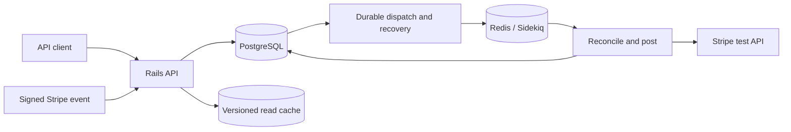

# Ledgerly

Ledgerly is a Rails API project for metered usage, invoicing, and reliable Stripe reconciliation. The application lives in `app/`; the existing reference repositories are separate from application code.

Work follows [ROADMAP.md](ROADMAP.md), the source of truth for scope, acceptance and measured evidence. All four milestones are implemented and locally accepted; hosted quality/Compose checks gate the published revision. The core API records idempotent usage, issues invoices and balanced journals atomically, and reconciles signed Stripe events through a durable outbox. PostgreSQL protects both delivery identity and logical payment/refund identity. This release supports Stripe **test mode**.

Read the [API reference](docs/API.md), [billing rules](docs/BILLING_RULES.md), [schema and architecture](docs/ARCHITECTURE.md), [Stripe setup/replay](docs/STRIPE_RELIABILITY.md), [operations](docs/OPERATIONS.md), [typing](docs/TYPING.md) and [release checks](docs/RELEASE.md). Benchmark raw evidence is published with its limitations; resume claims must follow [the evidence guide](docs/RESUME.md).



## Measured evidence

The Milestone 3 fixture has **50,000 invoices and 150,000 usage events**. Two baseline passes and two warm optimized passes used the same business-data fingerprints, shared 2-vCPU VM, resource caps and 40 read arrivals/s. Values below are client-observed **p95 milliseconds**:

| Endpoint | Baseline, two passes | Warm optimized, two passes |
| --- | ---: | ---: |
| Invoice list page 1 | 30.81 / 30.36 | 15.89 / 15.93 |
| Invoice list page 10 | 756.52 / 53.32 | 11.12 / 10.46 |
| Customer balance | 40.26 / 95.32 | 10.98 / 12.07 |

[The comparison](docs/benchmarks/2026-11-21-optimized-v1/README.md) preserves both repeats, uncached results, single cold application-cache misses, SQL profiles, failed candidates and raw requests. PG/OS caches were not flushed and baseline tails varied substantially. These numbers identify the **Milestone 3 measured source**, before Milestone 4 signatures; they are not a new performance measurement of every later revision.

The signed correctness replay delivered **180,000 shuffled/repeated events across all 50,000 invoices**, yielding exactly 50,000 payments and 5,000 refunds with balanced journals. It is service-level correctness with an in-process provider. Separate HTTP/Sidekiq testing completed 5,387 unique events in 64.86 seconds including offering/drain, with 15 client capacity drops. **5,000 processed events/minute was not demonstrated.** No actual Stripe load was generated. [Benchmark reproduction](docs/BENCHMARKS.md).

## Foundation stack

| Component | Version / purpose |
| --- | --- |
| Ruby | 3.4.13, recorded in `app/.ruby-version` |
| Rails | 8.1.4.1, API mode |
| Bundler | 4.1.0; dependency versions are committed in `app/Gemfile.lock` |
| PostgreSQL | 17.12 container; authoritative application database |
| Redis | 8.2.3 container; Sidekiq queues and bounded billing read caches |
| Background jobs | Sidekiq, concurrency 5 |
| Stripe | Ruby SDK 21.1.0; API 2026-11-18.endive; test mode only |
| Recovery | Independent database outbox sweep every 15 seconds |
| Quality checks | RSpec, SimpleCov (90% line / 80% branch floors), RuboCop, Sorbet + Tapioca 0.20.0 |

The roadmap records the change from the original Rails 7 proposal. The Docker image is for development and testing; production deployment is outside this milestone.

## Start with Docker Compose

Install Docker with Compose, then run these commands from the repository root:

```sh
cp .env.example .env
ruby -rsecurerandom -e 'puts SecureRandom.hex(32)'
```

Replace the blank `API_KEY=` value in `.env` with the generated value. If Ruby is unavailable on the host, generate a random key with your password manager. `.env` is ignored by Git; the example contains no application API key.

```sh
docker compose build api
docker compose up --no-build -d --wait
docker compose ps -a
curl --fail http://127.0.0.1:3000/up
curl --fail http://127.0.0.1:3000/ready
docker compose exec api bin/smoke
docker compose exec -T api ruby script/core_smoke.rb
docker compose exec -T api bin/rails ledgerly:audit
```

Compose loads the root `.env` automatically. The `setup` service prepares the development database and exits successfully; this is expected. The API, worker, and recovery loop start after setup completes. PostgreSQL and Redis have no published host ports; the API binds to `127.0.0.1:3000` by default. Set `PORT` in `.env` to change the host port.

The smoke script verifies database connectivity, enqueues `FoundationSmokeJob`, and waits for the worker's result in a unique Redis key that expires after 60 seconds. It checks actual background-job execution in addition to API readiness. `script/core_smoke.rb` creates a unique synthetic customer/plan/subscription, posts usage twice, verifies conflicts and invoice replay, and checks the cached receivable balance. It creates local test records and never requests Stripe collection.

```sh
docker compose logs --tail=100 api sidekiq recovery setup
docker compose run --rm -e RAILS_ENV=test -e TEST_DB_DATABASE=ledgerly_test -e REDIS_URL=redis://redis:6379/1 api bin/ci
docker compose down
```

Database and Redis volumes survive `docker compose down`. The image contains a copy of the source; there is no source bind mount. Rebuild with `docker compose build api`, then run `docker compose up --no-build -d --wait` after code or dependency changes. All application services share the image built by the API service. Standalone `docker-compose` can replace `docker compose` if that is how Compose is installed locally.

## Run natively

Use Ruby 3.4.13 and Bundler 4.1.0 with a running PostgreSQL 17 server and a compatible Redis server. Add the selected Ruby's `bin` directory to `PATH` before using `ruby`, `gem`, or `bundle`. On macOS, a Homebrew PostgreSQL installation may also require its `bin` directory on `PATH` when compiling the `pg` gem.

Create `.env` and set `API_KEY` as described above. Adjust `DB_USERNAME`, `DB_PASSWORD`, `DB_HOST`, and `DB_PORT` for an existing local PostgreSQL role that can create the development and test databases. The example role `ledgerly` is created by the PostgreSQL container; native installations must supply their own role or create it explicitly.

Rails does not automatically load the root `.env` in native mode. Export it in each terminal before starting application commands:

```sh
# From the repository root:
set -a
source .env
set +a
cd app
gem install bundler --version 4.1.0
bundle install
bin/setup --skip-server
bin/rails server -b 127.0.0.1
```

`bin/setup --skip-server` installs missing gems and prepares both development and test databases without launching the server. In a second terminal, load the same environment and run the worker:

```sh
set -a
source .env
set +a
cd app
bundle exec sidekiq -C config/sidekiq.yml
```

In a third terminal with the same environment, run `bin/rails runner script/recovery_loop.rb` from `app/` to dispatch durable work independently of the API.

With the API and worker running, execute `bin/smoke` from `app/` in another terminal with the same exported environment. Native Redis defaults to database 0 for development; use database 1 for tests. These are logical namespaces, so use an isolated Redis instance when testing alongside other applications.

## API foundation

All responses use JSON. Core business routes and examples are documented in [docs/API.md](docs/API.md).

| Request | Authentication | Response |
| --- | --- | --- |
| `GET /up` | Public | `200` with `{"status":"ok"}` when the application is live |
| `GET /ready` | Public | `200` when PostgreSQL and Redis are available; otherwise `503` |
| `GET /api/v1/status` | `Authorization: Bearer <API_KEY>` | `200` with `{"data":{"service":"ledgerly","status":"ok"}}` |

Readiness returns `{"status":"ok","checks":{"postgres":"ok","redis":"ok"}}`. Unavailable dependencies use `"unavailable"` in their check and the overall status; internal exception details are not exposed.

Missing, incorrect, or malformed authentication returns `401`. An empty or missing configured `API_KEY` fails closed with `503`. The `/webhooks/stripe` endpoint verifies Stripe signatures separately from API-key authentication.

Errors have the shape `{"error":{"code":"...","message":"..."}}`:

| Condition | HTTP status | Code |
| --- | --- | --- |
| Malformed JSON | 400 | `invalid_json` |
| Missing or invalid request parameters | 400 | `bad_request` |
| Unknown route with valid authentication | 404 | `not_found` |
| Active Record validation failure | 422 | `validation_failed` |

List endpoints default to `page=1&per_page=25`, allow at most 100 records per page, and require strictly positive integer parameters.

## Checks and CI

Run the complete local check from `app/` with the exported native environment:

```sh
RAILS_ENV=test TEST_DB_DATABASE=ledgerly_test REDIS_URL=redis://127.0.0.1:6379/1 bin/ci
```

Test database configuration ignores inherited `DB_DATABASE` and `DATABASE_URL` values. It defaults to `ledgerly_test`; use `TEST_DB_DATABASE` or an explicit `TEST_DATABASE_URL` to override it. The resolved test database name must end in `_test` or `_test_<digits>`, so an accidental development database selection aborts before tests run. Database host and credentials still come from the shared `DB_*` settings unless the test URL overrides them. Use a dedicated test database and Redis namespace.

The check prepares the test database and runs RSpec with **90% line / 80% branch coverage floors**, RuboCop, Sorbet, positive/negative type-contract probes, gem/schema RBI drift checks and Rails autoload checks. SimpleCov starts before Rails and writes `app/coverage/index.html`. Core model and billing/Stripe service bodies are checked; controllers/serializers and external JSON remain gradual boundaries. [Typing scope and regeneration](docs/TYPING.md).

GitHub Actions uses PostgreSQL/Redis services for the same quality command and saves coverage with the exact commit/run identity. A second job builds the image from clean source, boots Compose, runs health checks, real-worker smoke and the HTTP billing replay flow, then removes only its disposable volumes. Actions are pinned to immutable commits. [Workflow](.github/workflows/ci.yml) · [Hosted results](https://github.com/amovingman/Ledgerly/actions/workflows/ci.yml).

## API example

With the app running and `API_KEY` exported from your ignored environment:

```sh
curl --fail-with-body http://127.0.0.1:3000/api/v1/customers \
  -H "Authorization: Bearer $API_KEY" -H 'Content-Type: application/json' \
  --data '{"customer":{"name":"Acme","email":"billing@example.test"}}'
```

Use the returned identity in the [plan → subscription → usage → invoice examples](docs/API.md). Amounts are integer minor units, currencies stay separate, and client-supplied totals/ledger attributes are ignored. A first usage key creates one result; an identical retry returns its immutable body, while a changed payload conflicts. Invoice issuance closes that subscription/month to new late usage. Reads require the same API key; Stripe webhooks verify their signature separately.

Run `docker compose exec -T api ruby script/core_smoke.rb` for an executable version of that flow. Stripe collection, failed-payment reconciliation and partial/full refunds use the separate [test-sandbox procedure](docs/STRIPE_RELIABILITY.md); a 202 collection response is durable intent, not proof of payment.

## Verification and release boundaries

Saved evidence covers [Milestone 1](docs/verification/milestone-1/README.md), [Milestone 2](docs/verification/milestone-2/README.md), [Milestone 3](docs/benchmarks/2026-11-21-optimized-v1/README.md) and [final release acceptance](docs/verification/milestone-4/README.md). [RELEASE.md](docs/RELEASE.md) documents clean checks, the repeatable test-mode demo and publishing. [OPERATIONS.md](docs/OPERATIONS.md) documents financial audits, durable/queued work, dead jobs and safe replay.

This is a portfolio/test-mode API release. Production deployment, tax/discount/proration, FX, disputes, payouts/fees, additional payment-method contracts and a second recurring Stripe subscription path are outside scope. The ledger records gross invoice/payment/refund effects; Stripe's dashboard cash balance can differ. Read [the accounting contract](docs/BILLING_RULES.md) before extending it.
