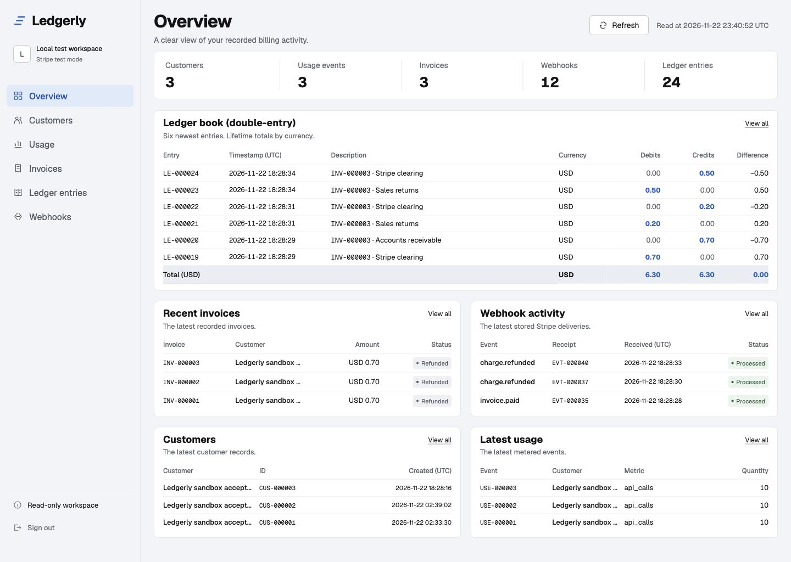
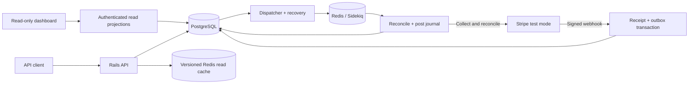

# Ledgerly

[](https://github.com/amovingman/Ledgerly/actions/workflows/ci.yml)

**Usage-based billing with auditable invoices and reliable Stripe reconciliation.**

Ledgerly is a Rails API that records metered usage, issues invoices atomically, and reconciles Stripe payments and refunds. Database constraints, transactions and durable recovery prevent duplicate financial effects when requests are retried or webhooks arrive concurrently and out of order.

A read-only dashboard makes the records inspectable: follow a customer’s usage into an invoice, examine both sides of its journal, and inspect the webhook that posted a payment or refund.

Built for **Stripe test mode**. All planned milestones are complete; [ROADMAP.md](ROADMAP.md) records scope, decisions and acceptance evidence.



*The dashboard above uses existing local sandbox records. A fresh installation starts empty.*

## Features

- **Metered usage:** customer-scoped idempotency keys, immutable replay responses and conflicts for changed payloads.
- **Invoice generation:** UTC monthly billing, snapshotted prices, one-time usage allocation and balanced issuance journals in one transaction.
- **Stripe reconciliation:** signed webhook receipts, delivery and business-effect deduplication, failed payments and multiple partial refunds.
- **Durable background work:** transactional outbox, independent recovery, bounded retries with jitter, and inspectable dead/review states.
- **Financial inspection:** customer balances derived from ledger rows, exact integer amounts and separate totals for each currency.
- **Read-only dashboard:** customers, usage, invoices, ledger entries and webhook status, with search, filters, pagination and drill-downs.

## Stack

| Layer | Technology |
| --- | --- |
| Application | Ruby 3.4.13 · Rails 8.1.4.1 in API mode |
| Source of truth | PostgreSQL 17.12 |
| Jobs and caching | Sidekiq · Redis 8.2.3 |
| Payments | Stripe Ruby SDK 21.1.0 · API `2026-11-18.endive` |
| Dashboard | Rails views · native JavaScript modules · CSS · self-hosted fonts |
| Quality | RSpec · SimpleCov · Sorbet/Tapioca · RuboCop · Node/Python checks |
| Development and CI | Docker Compose · GitHub Actions |

The application lives in `app/`. The dashboard needs no separate frontend server or npm build.

## Quick start

Install Docker with Compose, then clone the repository:

```sh
git clone https://github.com/amovingman/Ledgerly.git
cd Ledgerly
cp .env.example .env
```

Set `API_KEY` in `.env` to a random secret, using a password manager or the generation command in `.env.example`. Then start the stack:

```sh
docker compose up --build -d --wait
curl --fail http://127.0.0.1:3000/ready
```

Open **[the dashboard](http://127.0.0.1:3000/dashboard)** and sign in with the configured `API_KEY`. The browser receives a short-lived encrypted session; that session cannot authorize API writes. [Dashboard setup and access details](docs/DASHBOARD.md).

Compose starts the API, PostgreSQL, Redis, Sidekiq and the independent recovery process. The `setup` container prepares the database and exits successfully. The API binds to localhost; set `PORT` in `.env` to change its default port of 3000.

Core usage and invoicing work without Stripe credentials. For collection and webhooks, add test-mode credentials to the ignored `.env` and follow [the Stripe setup guide](docs/STRIPE_RELIABILITY.md).

### Run the executable demo

With the stack running:

```sh
docker compose exec -T api bin/smoke
docker compose exec -T api ruby script/core_smoke.rb
docker compose exec -T api bin/rails ledgerly:audit
```

The worker smoke checks real Sidekiq execution. The core smoke creates synthetic local records, replays usage and invoice requests, verifies conflicts and checks the resulting balance. It does not request Stripe collection. The audit checks eight accounting invariants.

```sh
docker compose logs --tail=100 api sidekiq recovery
docker compose down
```

Database and Redis volumes survive `down`. After source changes, use `docker compose up --build -d --wait` to rebuild the shared application image; the development stack has no source bind mount.

## Architecture



PostgreSQL owns financial state. Redis holds queues and disposable read caches. Webhook receipts and dispatch intent commit together before acknowledgment; recovery covers interruptions between the database and Sidekiq. Stripe network calls stay outside long-running database transactions.

### Reliability rules

| Boundary | Protection |
| --- | --- |
| Usage request | A customer/key identifies one normalized payload. An identical retry returns the original result; a changed payload returns `409`. |
| Invoice issuance | A unique subscription/month and one transaction protect invoice creation, line items, allocation and the issuance journal. |
| Webhook delivery | A unique Stripe event ID deduplicates receipt storage. |
| Financial effect | Separate payment/refund identities prevent distinct events describing the same effect from posting it twice. |
| Stripe collection | Persisted intent, stable idempotency keys and remote-state reconciliation protect interrupted outgoing operations. |
| Ledger | Immutable journals contain multiple rows whose debits and credits balance within one currency. |

These guarantees are backed by the tested contracts in [billing rules](docs/BILLING_RULES.md) and [Stripe reliability](docs/STRIPE_RELIABILITY.md). An acknowledged webhook or accepted collection intent does not itself mean payment has completed.

## API

Business routes use JSON and `Authorization: Bearer <API_KEY>`. Stripe webhooks use signature verification instead. Public `/up` and `/ready` routes expose liveness and dependency readiness.

| Operation | Route |
| --- | --- |
| Create customers and plans | `POST /api/v1/customers` · `POST /api/v1/plans` |
| Subscribe a customer | `POST /api/v1/subscriptions` |
| Record usage | `POST /api/v1/usage_events` with `Idempotency-Key` |
| Issue a monthly invoice | `POST /api/v1/subscriptions/:id/invoices` |
| Inspect invoices | `GET /api/v1/customers/:id/invoices` · `GET /api/v1/invoices/:id` |
| Read receivables | `GET /api/v1/customers/:id/balance` |
| Request or inspect collection | `POST` / `GET /api/v1/invoices/:id/collection` |
| Receive Stripe events | `POST /webhooks/stripe` |
| Inspect a webhook receipt | `GET /api/v1/stripe_events/:stripe_id` |

For example, export your local environment and create a customer:

```sh
set -a
source .env
set +a

curl --fail-with-body http://127.0.0.1:3000/api/v1/customers \
  -H "Authorization: Bearer $API_KEY" \
  -H 'Content-Type: application/json' \
  --data '{"customer":{"name":"Acme","email":"billing@example.test"}}'
```

Continue through the [plan → subscription → usage → invoice examples](docs/API.md). That reference includes request bodies, errors, pagination and replay behavior. Amounts use integer minor units; quantities are integers; periods use UTC and an exclusive end boundary.

## Measured results

Every number below links to saved evidence. Measurements describe their recorded source, workload and resources; the dashboard was added afterward and was not included in these load tests.

| Measurement | Observed result | Evidence |
| --- | --- | --- |
| Deterministic dataset | 50,000 invoices and 150,000 usage events | [Fixture and baseline](docs/benchmarks/2026-11-21-baseline-v1/README.md) |
| Duplicate/out-of-order replay | 180,000 signed service-level deliveries; exactly 50,000 payments and 5,000 refunds, with zero duplicate logical effects in the tested scenarios | [Correctness replay](docs/benchmarks/2026-11-21-optimized-v1/full-replay.json) |
| Sustained reconciliation | 5,395–5,403 unique completions/minute for seven minutes, with zero HTTP failures or client drops | [Accepted queue retest](docs/benchmarks/2026-11-22-queue-v2/README.md) |
| Pending work in that run | Peak 42 sampled / 76 reconstructed from record timestamps; ending pending work zero | [Queue acceptance](docs/benchmarks/2026-11-22-queue-v2/three-workers-clean/queue-acceptance.json) |
| Historical recovery sweep | 200,042 SQL statements reduced to three | [Optimization profile](docs/benchmarks/2026-11-21-optimized-v1/README.md) |

The accepted throughput run used a **four-vCPU VM, three workers × four threads, aggregate worker caps of 3 CPUs/1.5 GiB, and PostgreSQL limited to one CPU with a 10 ms quota period**. It reconciled against a local read-only HTTP provider through the real Stripe SDK; it did not generate external Stripe load or outgoing charges. The reconstructed peak is a timestamp estimate, not an exact instantaneous Redis maximum. Earlier failed runs remain in the report.

### Matched read latency

Client-observed **p95 milliseconds**, measured at 40 arrivals/s on the same 50k fixture and two-vCPU VM:

| Endpoint | Baseline, two passes | Warm optimized, two passes |
| --- | ---: | ---: |
| Invoice list, page 1 | 30.81 / 30.36 | 15.89 / 15.93 |
| Invoice list, page 10 | 756.52 / 53.32 | 11.12 / 10.46 |
| Customer balance | 40.26 / 95.32 | 10.98 / 12.07 |

[Full comparison and reproduction](docs/BENCHMARKS.md). Baseline tails varied; both repeats are retained. PostgreSQL/OS caches were not flushed. [The evidence guide](docs/RESUME.md) explains which claims these runs support.

## Tests and CI

[Hosted acceptance](docs/verification/milestone-5/hosted-ci.json) recorded **241 RSpec examples**, **five frontend checks**, **97.55% application line coverage** and **84.27% branch coverage**. The separate local benchmark-script regression suite has five tests.

With the Compose stack running, run the Ruby quality gate against its dedicated test database and Redis namespace:

```sh
docker compose run --rm --no-deps \
  -e RAILS_ENV=test \
  -e TEST_DB_DATABASE=ledgerly_test \
  -e REDIS_URL=redis://redis:6379/1 \
  api bin/ci
```

Optional host-side checks, using Node and Python:

```sh
node --test scripts/test_dashboard.mjs
python3 -m unittest discover -s scripts -p 'test_*.py'
```

`bin/ci` runs RSpec, SimpleCov coverage floors of **90% line / 80% branch**, RuboCop, Sorbet, positive/negative type probes, generated-RBI drift and Rails autoload checks. The test database guard rejects development database names. Coverage is written to `app/coverage/index.html`.

GitHub Actions runs the quality gate and frontend tests, then builds a fresh Compose stack to verify startup, HTTP billing and real background execution. [Workflow](.github/workflows/ci.yml) · [CI runs](https://github.com/amovingman/Ledgerly/actions/workflows/ci.yml) · [Typing scope](docs/TYPING.md).

## Documentation

| Guide | Contents |
| --- | --- |
| [Roadmap](ROADMAP.md) | Completed milestones, decisions and measured evidence |
| [API reference](docs/API.md) | Requests, responses, errors and idempotency contracts |
| [Billing rules](docs/BILLING_RULES.md) | Periods, prices, allocation and accounting |
| [Architecture](docs/ARCHITECTURE.md) | Schema, relationships and data flow |
| [Stripe reliability](docs/STRIPE_RELIABILITY.md) | Sandbox setup, collection, recovery and safe replay |
| [Dashboard](docs/DASHBOARD.md) | Views, authentication and read-only access |
| [Operations](docs/OPERATIONS.md) | Audits, queue inspection, failures and recovery |
| [Benchmarks](docs/BENCHMARKS.md) | Fixtures, workloads and reproducible measurements |
| [Release checks](docs/RELEASE.md) | Clean setup and repeatable acceptance |
| [Security review](docs/verification/secret-scan-2026-11-22.md) | Credential scan scope, findings and local cleanup |

<details>
<summary>Run without Docker</summary>

Use Ruby 3.4.13 and Bundler 4.1.0 with a running PostgreSQL 17 server and a compatible Redis server. Add the selected Ruby's `bin` directory to `PATH` before using `ruby`, `gem`, or `bundle`. On macOS, a Homebrew PostgreSQL installation may also require its `bin` directory on `PATH` when compiling the `pg` gem.

Create `.env` and set `API_KEY` as described above. Adjust `DB_USERNAME`, `DB_PASSWORD`, `DB_HOST`, and `DB_PORT` for an existing local PostgreSQL role that can create the development and test databases. The example role `ledgerly` is created by the PostgreSQL container; native installations must supply their own role or create it explicitly.

Rails does not automatically load the root `.env` in native mode. Export it in each terminal before starting application commands:

```sh
# From the repository root:
set -a
source .env
set +a
cd app
gem install bundler --version 4.1.0
bundle install
bin/setup --skip-server
bin/rails server -b 127.0.0.1
```

`bin/setup --skip-server` installs missing gems and prepares both development and test databases without launching the server. In a second terminal, load the same environment and run the worker:

```sh
set -a
source .env
set +a
cd app
bundle exec sidekiq -C config/sidekiq.yml
```

In a third terminal with the same environment, run `bin/rails runner script/recovery_loop.rb` from `app/` to dispatch durable work independently of the API.

With the API and worker running, execute `bin/smoke` from `app/` in another terminal with the same exported environment. Native Redis defaults to database 0 for development; use database 1 for tests. These are logical namespaces, so use an isolated Redis instance when testing alongside other applications.

</details>

## Scope

Ledgerly is a test-mode portfolio project. It supports integer metered quantities, fixed per-unit prices, UTC monthly periods and one currency per invoice. Production deployment, taxes, discounts, prorations, foreign exchange, disputes and payout/fee accounting are outside the completed scope. The ledger records gross invoice/payment/refund effects, so its balances can differ from Stripe’s cash balance.
