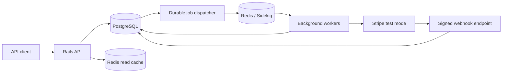

# Ledgerly Project Roadmap

Created: 2026-11-21
Status: Milestones 0–5 are implemented and locally accepted for the Stripe test-mode portfolio project. The user has authorized publishing all outstanding performance and dashboard work; release commits and hosted CI verification are in progress. Historical measurements retain their original source identities.
Project name: Ledgerly. The current workspace directory is named `Ledgerdy`.

## How to use this file

This file is the source of truth for project scope, progress, decisions, and evidence.

- Read it before starting project work and reference the relevant milestone in updates.
- Complete work in dependency order. The four weeks below are planning estimates, not completion claims.
- Check a task only after its acceptance checks pass. Record the commands, results, and evidence paths in the work log.
- Update this file when scope or implementation decisions change, and identify the next unfinished task before stopping.
- Keep actual measurements separate from targets. Never put an unmeasured target on a resume.

## Goal and scope

Build a Rails API that ingests metered usage, generates invoices, and reconciles Stripe test-mode payments while preventing duplicate billing effects during retries, concurrent execution, and out-of-order webhook delivery.

Initial scope: one currency per invoice, integer quantities, fixed per-unit metered prices, UTC billing periods, and Stripe test mode. Taxes, discounts, prorations, foreign exchange, production payment rollout, are outside the initial release. A read-only web dashboard is now authorized as Milestone 5; billing mutations remain API-only.

Use the foundation stack: Rails 8.1 API mode (updated from the proposed Rails 7; see decision log), PostgreSQL, Sidekiq, Redis, Stripe, RSpec, SimpleCov, Sorbet, RuboCop, Docker Compose, and GitHub Actions. Confirm and pin compatible, supported dependency versions during setup; record any change to the proposed Rails major version before implementation.

## Billing and reliability rules

1. PostgreSQL is authoritative for usage, invoices, payment state, and ledger balances. Redis is for queues and disposable read caches.
2. Store money in integer minor units with an explicit currency. Snapshot prices on invoice lines so later plan changes cannot change historical invoices.
3. Use half-open billing periods: `period_start <= occurred_at < period_end`. Define the late-usage policy before implementing invoice generation.
4. Enforce idempotency with database uniqueness and transactions. Application-level existence checks alone are insufficient under concurrency.
5. The same usage key and payload returns the original result. Reusing that key with a different payload returns a conflict.
6. Generating the same subscription-period invoice repeatedly or concurrently produces one invoice, one set of line items, and one issuance journal.
7. Each journal has multiple debit/credit rows whose totals match within one currency. Do not assert that there is exactly one ledger row per Stripe event.
8. Deduplicate both webhook delivery by Stripe event ID and financial effects by the underlying payment/refund identity. Different events may describe the same payment.
9. Use Stripe-managed invoice collection for the initial integration: a local invoice maps to one Stripe invoice. Do not also create a separate charge or PaymentIntent for that invoice. Subscription synchronization must not create a second recurring billing path.
10. Persist stable idempotency keys and remote identifiers for outgoing Stripe operations. Recover from timeouts by reconciling remote state before creating a new operation.
11. Persist webhook receipt before acknowledging it. A durable dispatch record and recovery process must cover failure between database commit and Sidekiq enqueue.
12. Retryable failures must leave work recoverable. A crash after applying an effect must not cause that effect to be applied twice.

## Architecture



Keep Stripe network calls outside long-running database transactions. Persist intent first, perform the remote operation with a stable idempotency key, and then persist the result. Recovery jobs reconcile interrupted transitions.

## Data model checklist

| Entity | Required data and constraints |
| --- | --- |
| `customers` | API identity, billing identity, unique nullable Stripe customer ID |
| `plans` | Metric, integer unit price, currency, billing cadence |
| `subscriptions` | Customer/plan references, lifecycle, billing boundaries, Stripe mapping when applicable |
| `usage_events` | Customer/subscription, metric, positive integer quantity, occurrence time, idempotency key, request fingerprint; unique key within its documented scope |
| `invoices` | Subscription, billing period, currency, amount, lifecycle, unique Stripe invoice ID; unique subscription and billing period |
| `invoice_line_items` | Invoice, metric, aggregated quantity, snapshotted price, amount, usage allocation reference |
| `ledger_transactions` | Journal type, invoice/payment/refund reference, unique business-effect key |
| `ledger_entries` | Journal, account, debit, credit; invoice/currency via the journal; nonnegative amounts and exactly one positive side per row |
| `stripe_events` (Milestone 2) | Unique Stripe event ID, type, raw payload, processing state, attempts, last error, processing timestamps |
| `outbox_records` (Milestone 2) | Durable dispatch intent, destination job, reference, availability and dispatch state |

Add foreign keys and correctness constraints from the start. Preserve those in the baseline; defer optional performance indexes to the optimization milestone. Journal balance needs transaction-level validation and tests; row-level checks alone cannot enforce a total across multiple entries.

## Milestone 0 — Foundation (start of Week 1)

- [x] Confirm Ruby/Rails/dependency versions and record them in the decision log.
- [x] Scaffold the API application in a dedicated `app/` directory, keeping the existing reference repositories separate.
- [x] Add Docker Compose services for API, PostgreSQL, Redis, and Sidekiq, with health checks and persistent database storage.
- [x] Add `.env.example`, ignored secrets, and documented setup/migration/test commands.
- [x] Configure RSpec, SimpleCov, RuboCop, and Sorbet. Start coverage collection before application code loads.
- [x] Establish API-key authentication, JSON validation/error conventions, pagination limits, and a health endpoint. Stripe webhooks use signature verification instead of API-key authentication.
- [x] Create an initial GitHub Actions workflow for RSpec and RuboCop; expand it in Week 4.

Acceptance status: passed from a clean GitHub checkout. All services booted healthy, setup exited 0, the real worker smoke passed, and `bin/ci` passed (44 examples; clean lint and initial typing). The first hosted GitHub Actions run passed. See [verification evidence](docs/verification/milestone-0/README.md).

Acceptance: a clean checkout can boot the services, create/migrate the database, serve health checks, and run a smoke test using documented commands. No secrets are committed.

## Milestone 1 — Core API and accounting (Week 1)

- [x] Implement migrations, models, relationships, and required database constraints.
- [x] Implement customer and plan creation/read endpoints plus subscription creation, retrieval, and supported lifecycle transitions.
- [x] Document usage idempotency scope, subscription overlap rules, rounding, billing boundaries, and late-usage handling. See [billing rules](docs/BILLING_RULES.md).
- [x] Implement `POST /api/v1/usage_events` with request fingerprints and database-backed idempotency.
- [x] Implement invoice generation for one subscription-period in a database transaction, including line items, usage allocation, and a balanced issuance journal.
- [x] Implement paginated customer invoice lists, invoice detail, and ledger-derived balance endpoints.
- [x] Add request/service tests for validation, authentication, boundary timestamps, price snapshots, duplicate requests, payload conflicts, rollback, and concurrent invoice generation.

Acceptance status: passed from a clean GitHub checkout and fresh schema load. All 138 specs, lint, initial typing, autoload checks and hosted CI passed. Live four-request HTTP duplicate tests produced one event/invoice and balanced entries. See [Milestone 1 evidence](docs/verification/milestone-1/README.md).

Acceptance: repeated and concurrent usage requests have one stored result; repeated and concurrent invoice generation produces one invoice; no usage is billed in two invoices; failed generation leaves no partial invoice or ledger state; every journal balances.

## Milestone 2 — Stripe integration and recovery (Week 2)

- [x] Confirm current Stripe SDK/API contracts against official documentation and pin the API version used by fixtures and tests. SDK 21.1.0 / API 2026-11-18.endive.
- [x] Implement the local-invoice-to-Stripe-invoice workflow with stable outgoing idempotency keys and persisted operation state.
- [x] Implement webhook signature verification against the exact request bytes, with invalid signatures rejected before storage or dispatch.
- [x] Store verified events durably under a unique Stripe event ID and write dispatch intent in the same database transaction.
- [x] Implement the outbox dispatcher and a recovery sweep for undispatched events and interrupted processing.
- [x] Process `invoice.paid`, `invoice.payment_failed`, and `charge.refunded` with database locking, business-effect uniqueness, and transactional ledger/state updates.
- [x] Support multiple partial refunds using individual refund identities; prevent cumulative refunded amounts from exceeding the recognized payment.
- [x] Handle unknown event types, missing mappings, duplicate events, and stale/out-of-order state transitions explicitly. Reconcile against Stripe where local information is insufficient.
- [x] Configure bounded exponential retry backoff with jitter, Sidekiq dead-job handling, failure inspection, and safe manual replay.
- [x] Test concurrent delivery, distinct event IDs for the same payment, duplicate refund notifications, and crashes before/after commit or enqueue.

Acceptance status: passed locally from a fresh schema-loaded database: 195 specs, 117 clean linted files, scoped typing/autoload passing, real Redis interruption recovery, and a real Stripe sandbox payment/refund demonstration with 12 reverse-order duplicate replays. See [Milestone 2 evidence](docs/verification/milestone-2/README.md) and [Stripe operations guide](docs/STRIPE_RELIABILITY.md). No commits, pushes, or hosted CI runs were performed.

Acceptance: replaying events two or three times in shuffled order produces the same financial state as one successful processing pass. There is one journal per logical financial effect, balanced entries, and no repeated Stripe collection. Temporary failures recover, and exhausted jobs remain inspectable and replayable.

## Milestone 3 — Baseline, load, and optimization (Week 3)

- [x] Write a deterministic, rerunnable test-data generator for at least 50,000 invoices with realistic customer distribution, line items, usage, payments, and ledger records.
- [x] Verify fixture counts and accounting invariants before benchmarking. Run benchmarks only against an isolated test environment.
- [x] Write repeatable load scenarios for signed webhook ingestion and a heavy endpoint such as the customer invoice list.
- [x] Record the baseline source identity, machine/container resources, worker concurrency, dataset seed, endpoint parameters, warm-up, duration, arrival rate, and cache state. Base Git revision plus local SHA-256 manifests are used while commits are suspended.
- [x] Run and save the baseline before adding performance optimizations. Keep required integrity indexes enabled.
- [x] Capture endpoint p50/p95/p99, request failures, incoming event rate, successfully processed unique event rate, queue latency, backlog, query counts, and database query plans. Completed two read passes, one steady webhook probe and one overloaded trial; limitations are recorded.
- [x] Add query-informed composite/partial indexes, filter recovery work in SQL, check list/detail/balance paths with Bullet (no N+1 found), and preserve bounded pagination.
- [x] Add bounded Redis caching for balance/invoice-header reads with transaction-versioned invalidation. Cache outage fallback, committed payment while Redis is down, rollback, stale SQL snapshots and late fills all pass.
- [x] Re-run the identical workloads on matching business fingerprints and resource caps. Save cache-off results, two warm repeats and separate single cold application-cache misses; PG/OS caches were not cleared.
- [x] Run duplicate/out-of-order replay across all 50,000 invoices: 180,000 signed service-level deliveries / 60,000 distinct events, exactly 50,000 payments and 5,000 refunds, balanced journals and zero receivables per currency. Corrected observer snapshots bypass SQL query caching; fresh audits and repeated replay pass.
- [x] Save the comparison, reproducible commands, raw outputs, preserved failures, base Git revision and image/source SHA-256 manifests, with cold/warm and throughput limitations.

Acceptance status: complete locally. The [immutable baseline](docs/benchmarks/2026-11-21-baseline-v1/README.md) and [optimized comparison](docs/benchmarks/2026-11-21-optimized-v1/README.md) retain both read repeats, cache-off/cold-miss/warm results, full webhook queue/drain evidence, the failed SDK-descriptor candidate, real Redis outage verification and all-invoice correctness replay. Final fresh-schema checks: 221 passing specs, 142 linted files clean, scoped typing/autoload passed, 96.99% line coverage. High-rate processing fully drained but had 15 client capacity drops and remained below 5,000 unique events/minute; that target was not claimed at Milestone 3 acceptance; the later sustained follow-up below has its own resource/source scope. The isolated mixed fixture was restored and benchmark services stopped. The refreshed development stack/worker are healthy, with financial counts unchanged. No commits or pushes.

Acceptance: another person can reproduce the measurements from the saved instructions. Throughput counts completed unique effects as well as accepted deliveries; backlog growth and error rates are disclosed. Performance changes preserve all correctness checks.

## Milestone 4 — Quality and portfolio release (Week 4)

- [x] Enforce greater than 90% application line coverage: final 1,256/1,288 (97.51%); branches 229/269 (85.13%). Coverage floors are 90% line / 80% branch.
- [x] Add useful Sorbet contracts to core models, billing services and webhook processors. 45 checked files / 147 signature declarations; typed result records and snapshot shapes; positive/negative probes and generated Rails interfaces. Dynamic boundaries remain documented.
- [x] Finish GitHub Actions with PostgreSQL/Redis, the full quality command, coverage artifacts with commit identity, RBI drift/autoload/type-probe gates and a separate clean Compose HTTP/worker job. Exact hosted results attach to each pushed revision.
- [x] Finish README/API/setup, architecture/schema, billing, Stripe configuration/replay, typing and release documentation.
- [x] Publish the measured baseline/comparison and raw evidence in commit `5976771`; add a hash-verified 157-file baseline source archive and optimized source revision for reconstruction. Preserve original evidence/manifests.
- [x] Document operational checks and add `ledgerly:status` plus a read-only financial audit. Corruption/allocation detection tests and real CLI checks pass.
- [x] Run final clean-source/fresh-database acceptance: 224 specs, 149 Ruby files lint clean, Sorbet/probes/RBI/autoload passed; fresh Compose HTTP/worker/audit passed; real Stripe sandbox decline→70¢ capture→20¢/50¢ refunds plus 12 reverse-order replays passed. Repeat 180,000 signed deliveries across all 50,000 invoices on the typed runtime; zero replay/invariant failures.
- [x] Write resume bullets using only saved measurements and explicit source/test scope. Do not claim 5,000 processed events/minute or an unmeasured latency result for Milestone 4.

Acceptance status: local release checks passed. [Milestone 4 report](docs/verification/milestone-4/README.md) records exact source/image hashes, clean setup, raw checks, measured coverage, type scope, sandbox and replay. The separate acceptance volumes were removed; the mixed 50k fixture was restored and benchmark services stopped. The ordinary development stack is healthy with retained test-mode data. Publishing uses a release-branch gate for the second commit and fast-forwards that same revision to main after hosted checks pass; [workflow results](https://github.com/amovingman/Ledgerly/actions/workflows/ci.yml) and its SHA-tagged coverage artifacts identify the final hosted result without an extra documentation-only commit.

Acceptance: clean setup succeeds, quality/CI gates pass, the demo is repeatable, and every numerical claim links to a completed measurement. The portfolio release is not a production payment rollout or a complete static proof of every dynamic path.

## Milestone 5 — Read-only operations dashboard

- [x] Add an authenticated browser session without exposing the API key in bundles, URLs or browser storage; preserve Bearer authentication and API mutation behavior. Encrypted HttpOnly/SameSite Strict cookie expires in 30 minutes; CSRF/origin checks protect sign-in/out. Cookie-only API writes are rejected.
- [x] Add bounded, paginated read projections for customers, metered usage, invoices, ledger entries and webhook processing state, with explicit customer/status filters. Sixteen dashboard request specs pass, including exact money above JavaScript's integer limit, excluded raw webhook payloads and CSRF-protected sign-out; full-suite acceptance passed.
- [x] Build overview/navigation and each requested view, customer/invoice drill-downs, search, pagination and refresh using actual local data. Keep integer money precise and currencies separate. User chose mockup A — Statement book; no synthetic records added.
- [x] Add loading, zero, empty, error and session-expiry states; keyboard/focus support, accessible tables and responsive mobile layouts. Phone ledger rows expose both debit and credit without hidden columns.
- [x] Verify authentication/CSRF, read-only behavior, pagination/filter isolation, financial totals and frontend interactions; run relevant full quality checks. 241 specs, 163 linted files, 97.28% line / 84.27% branch coverage; typing/probes/RBI/autoload and five native Node tests pass. Real browser sign-out uses explicit CSRF-protected POST (API mode has no HTML method override).
- [x] Inspect desktop/mobile in a real browser; document setup, screenshots and data scope. [Setup](docs/DASHBOARD.md) and [evidence](docs/verification/milestone-5/README.md). All five areas visible at 1440×900; labelled records verified at 390px; financial counts and eight accounting checks unchanged. No commits or pushes.
- [x] Close formal visual reproduction acceptance: refinement preserves the approved Statement book with compact real-data tables. Normal hero/desktop gates pass at **81.58% / 82.15%**, and the final comp-frame comparison is **82.04%**, above the unchanged 72% requirement. Independent verdict: **ship**, scoring the prior alignment/persistence fixes resolved. No thresholds, regions or phases were forced. Formal spatial comparison uses the actual 1487×1058 comp frame; 1440×900 and 1280×900 layout/overflow checks and 390px phone records are separately verified. Failed69.18% and normalized1440 crop reports are preserved, without claiming the latter passed.

Acceptance: an authenticated reviewer can trace a customer’s usage to invoices and balanced journal rows, and inspect webhook status/attempts/errors without changing billing records or replaying events. Data comes from PostgreSQL-backed reads, with no invented metrics; browser access does not authorize API writes. Existing backend checks and financial invariants remain passing.

## Sustained-throughput follow-up (2026-11-22)

- [x] Profile and run a five-minute baseline on current release `c9ed621`, using the isolated all-unpaid variant of the 50k dataset. Baseline failed the target: complete-minute counts 5,319 / 5,474 / 5,402 / 5,120 / 4,196; 113 client drops, zero HTTP failures, 1,349 events pending at offering end. All accepted work later drained and accounting checks passed. Monitoring/preflight failures are retained separately.
- [x] Remove two redundant normal-payment SQL reads and unchanged invoice writes; tune benchmark API/Sidekiq concurrency from five to eight with unchanged CPU/memory caps. Sequential 200-payment profile: 5,600 → 5,200 processing SQL statements; 1.869 → 1.624 CPU seconds. Final candidate checks: 225 passing specs, 151 clean linted files, typing/probes/RBI/autoload passing; 97.51% line / 85.09% branch coverage.
- [x] Complete the matched five-minute test and two longer seven-minute trials, retaining every result. On four VM CPUs/eight application threads, complete-minute unique completions were **5,399 / 5,399 / 5,400 / 5,401 / 5,400 / 5,381 / 5,418**. Zero HTTP failures/client drops; all 37,800 accepted events and exactly 33,600 new payment effects completed, ending backlog zero and measured queue trend zero. **Throughput target met; full conservative gate failed** because sampled peak pending was 349 against the predeclared 100 limit. The two-vCPU longer attempt was not reliable at this rate.
- [x] Save source/image/resource identities, reproducible commands, raw requests/queue samples, profiles and final accounting in the [follow-up report](docs/benchmarks/2026-11-22-sustained-v1/README.md). Restore the original mixed fixture (all 11 fingerprints match), stop benchmark services, restore two VM CPUs/four GiB and verify main readiness/unchanged financial counts with eight clean accounting checks.

[Detailed follow-up evidence](docs/benchmarks/2026-11-22-sustained-v1/README.md) separates the achieved throughput criterion from the failed stricter queue guard. Reconciliation completion p95 was 1,153.07 ms; HTTP acknowledgment p95 133.06 ms. This is local SDK/HTTP-provider reconciliation, with no external Stripe load or outgoing charges. This work stays local; the two requested Milestone 4 commits are already published.

## Queue-peak follow-up (2026-11-22)

- [x] Reproduce/profile the same four-vCPU, eight-worker-thread, 100-delivery/s, seven-minute workload. Instrumented one-process run: minimum complete minute 5,341; sampled pending peak 288, reconstructed timestamp peak 426. Accepted 37,800 distinct events / exactly 33,600 new payment effects, clean accounting. Full queue gate failed; prior sustained-v1 evidence remains unchanged.
- [x] Add optional benchmark-only slow-job stage/thread-CPU/GC diagnostics, per-second cgroup/VM pressure sampling, and timestamp-based pending reconstruction between observation samples. The SQL timeline is an estimate from record timestamps rather than commit order; preserve both measurements.
- [x] Add an independent benchmark worker-pool setting (default still follows `BENCHMARK_THREADS`). Verify the full image: 225 specs, 152 clean linted Ruby files, Sorbet/type probes/RBI/autoload passing. Test two worker processes with four threads each: eight total worker threads, same four-vCPU VM and API/provider settings; aggregate worker caps increase from 1 CPU/512 MiB to 2 CPUs/1 GiB.
- [x] Complete all comparisons and the clean three-worker seven-minute run. **Sampled peak 42 / timestamp-derived peak 76**, both strictly <100; every full minute **5,395–5,403** distinct completions; zero HTTP failures/client drops, zero ending pending, 37,800 accepted events / exactly 33,600 payment effects and eight clean accounting checks. Original sustained gate and the added strict gate both pass. Preserve the four-thread, twelve-thread and clean two-worker misses.
- [x] Save [queue follow-up evidence](docs/benchmarks/2026-11-22-queue-v2/README.md), image/source identities, runtime caps, profiles, raw requests and both peak measurements. Restore all 11 original mixed-fixture fingerprints, original PG 100 ms quota period, two-vCPU/four-GiB VM and healthy development services with unchanged financial counts/audit. No commits or pushes.

Acceptance result: the clean **three × four worker** run meets both peak guards on the four-vCPU VM, with optional Ruby profiling disabled and PostgreSQL limited to one CPU using a 10 ms quota period. Aggregate worker caps are **3 CPUs/1.5 GiB** versus the initial 1 CPU/512 MiB; total worker threads increase from eight to twelve. This uses additional worker burst capacity within the same VM, not a code-only comparison. A profiled two-worker trial passed at 61/88, but its clean confirmation missed at 99/147; three-worker evidence is the accepted configuration. Timestamp reconstruction is an estimate with commit-order limits, not an exact Redis maximum. Full checks: 225 specs / 152 linted files, typing/probes/RBI/autoload plus five Python regressions passing.

## Evidence and measurement register

Targets/examples come from the proposal. Only the actual-result column records achieved measurements, with the scope stated explicitly.

| Claim | Target / example | Required proof | Actual result |
| --- | --- | --- | --- |
| Event throughput | 5,000+ events/minute | Signed load test; accepted deliveries and completed unique events/minute; duration, errors, backlog and queue latency | Latest clean local run: **5,395–5,403 completed unique events in every minute for seven minutes**, 37,800 accepted events / 33,600 new payment effects, zero failures/drops/ending pending and clean accounting. Pending peaks **42 sampled / 76 timestamp-derived**, both <100; full sustained and strict queue gates pass. **Four VM CPUs; three × four worker threads; aggregate worker caps 3 CPUs/1.5 GiB; PG one CPU with 10 ms quota period.** Read-only local HTTP provider, not external Stripe throughput. [Queue results/resources/source](docs/benchmarks/2026-11-22-queue-v2/README.md). Earlier [sustained trials and misses](docs/benchmarks/2026-11-22-sustained-v1/README.md) remain unchanged. |
| Duplicate billing prevention | Zero duplicates in the tested scenarios | Concurrent, repeated and shuffled event replay; unique logical payment/refund journals; outgoing collection count; balanced ledger assertions | All 50,000 invoices participated in 180,000 shuffled signed service-level deliveries / 60,000 events. Exactly 50,000 payments, 5,000 refunds and 105,000 balanced journals / 210,000 rows; all receipts processed, eight checks clean and zero receivables per currency. In-process provider; not an external-charge throughput test. The final typed runtime repeats those totals and a fresh real Stripe sandbox capture/refund/replay passes. Scope remains the tested scenarios. [Replay](docs/benchmarks/2026-11-21-optimized-v1/full-replay.json) |
| Dataset size | At least 50,000 invoices | Seed command, deterministic seed, counts, and integrity checks | 50,000 invoices, 150,000 usage events, 40,000 initial payments, 5,000 refunds and 190,000 initial ledger rows. Rebuilds match 11 table fingerprints; all accounting checks passed. [Counts](docs/benchmarks/2026-11-21-baseline-v1/dataset-counts.json) |
| Heavy-endpoint latency | Example: p95 480 ms → 90 ms | Comparable baseline/optimized runs with identical fixtures and resources; request failures; cold/warm cache disclosure | At 40 arrivals/s, baseline p95s in two passes: page 1 30.81/30.36 ms, page 10 756.52/53.32 ms, balance 40.26/95.32 ms. Warm optimized repeats: 15.89/15.93, 11.12/10.46 and 10.98/12.07 ms respectively; zero failures/drops. Cache-off and separate single cold application-cache observations retained; PG/OS caches not flushed. Shared-VM baseline variability disclosed. [Comparison](docs/benchmarks/2026-11-21-optimized-v1/README.md) |
| RSpec coverage | Greater than 90%; stretch 94% | Full-suite command, SimpleCov configuration and report showing actual line coverage | Milestone 4: 1,256/1,288 application lines (97.51%); branches 229/269 (85.13%); 224 specs, zero failures. Enforced floors: 90% line / 80% branch. Follow-up: 225 passing specs, 1,257/1,289 lines (97.51%) and 234/275 branches (85.09%). Scripts, specs and lib/ helpers/tasks are outside application-only coverage. [Release checks](docs/verification/milestone-4/checks-release.log), [follow-up checks](docs/benchmarks/2026-11-22-sustained-v1/checks-optimized.log) |

Suggested evidence layout, to create as measurements are produced:

```text
docs/benchmarks/<run-id>/
  environment.md
  commands.md
  dataset-counts.json
  baseline.json
  optimized.json
  replay-results.txt
  query-plans.txt
  comparison.md
```

Store the commit and fixture identity with each run. Keep secrets and customer data out of evidence. A test with no duplicate charges supports a claim about those tested failure scenarios; it does not prove that duplicates are impossible under every condition.

## Definition of done for each milestone

- Relevant tasks and acceptance checks pass.
- Required automated checks pass, and important recovery/concurrency cases have evidence.
- Setup/API/operational documentation matches the implementation.
- This roadmap reflects completed work, open decisions, actual measurements, and the next task.

## Decision log

| Date | Decision | Rationale / follow-up |
| --- | --- | --- |
| 2026-11-21 | Use this roadmap as the project reference | Update it as implementation and evidence evolve. |
| 2026-11-21 | Keep the application in `app/` | The workspace currently contains reference repositories rather than an application. |
| 2026-11-21 | Use Stripe-managed invoice collection for the initial release | Map each local invoice to one remote invoice and avoid competing collection paths. Verify contracts during Milestone 2. |
| 2026-11-21 | Add journal headers and durable dispatch records | Provide business-effect uniqueness and recovery across database/queue boundaries. |
| 2026-11-21 | Move the foundation from Rails 7 to Rails 8.1 | Rails 7.2 reached its final release; use a security-supported release for new development. Sources: https://rubyonrails.org/2026/9/24/Rails-Version-7-2-4-has-been-released and https://rubyonrails.org/maintenance. |
| 2026-11-21 | Commit logical batches near 1,000 changed lines to `amovingman/Ledgerly` | User requested frequent commits; exclude bundled reference repositories and generated runtime files. |
| 2026-11-21 | Pin Ruby 3.4.13, Rails 8.1.4.1, Bundler 4.1.0 and all direct gems | RubyGems versions checked; `app/Gemfile.lock` includes macOS arm64 and Linux arm64/x86_64. Local tools: PostgreSQL 17.12, Redis 8.10.3, Docker 29.10.0, Compose 5.8.0, Colima 0.10.3. Container Redis is pinned independently in Compose. |
| 2026-11-21 | Scope the initial Sorbet check to strict pagination value objects | Keep the type check useful and passing now; model/service signatures expand in Milestone 4. |
| 2026-11-21 | Isolate test database settings from development | Tests use `TEST_DB_DATABASE` / `TEST_DATABASE_URL`, ignore inherited generic database overrides, and refuse names without a test suffix; CI/specs reject production invocation. |
| 2026-11-21 | Suspend all commits and pushes at user request | Keep Milestone 2 local; identify the accepted source with a SHA-256 manifest and base revision instead of creating a commit or running hosted CI. |
| 2026-11-21 | Pin Stripe SDK 21.1.0 / API 2026-11-18.endive; use invoice-managed collection only | Confirmed current SDK contracts and actual sandbox payment/refund flow. Support one full card payment per invoice and multiple partial refunds; unsupported snapshots enter review. |
| 2026-11-21 | Bound ambiguous outgoing creation to 23 hours | Reconcile remote operation metadata before retrying; refuse new creates beyond the conservative window. Manual replay preserves payloads, keys, and first-attempt timestamps. |
| 2026-11-21 | Run independent durable recovery every 15 seconds | Recover pending outbox work and dispatches/attempts stale for five minutes. Eight processing attempts with jittered backoff, dead/review inspection, and safe manual replay. |
| 2026-11-21 | Keep initial Sorbet scope while excluding incomplete Stripe vendor RBIs | `bin/typecheck` preserves other gem RBIs and strict pagination checks. Complete model/service/SDK typing remains Milestone 4. |
| 2026-11-21 | Complete the dataset/baseline phase before optimizing | User requested measurements first. Use separate volumes and fixture credentials, eager-loaded benchmark Rails, NullStore, a read-only provider stub, and fixed workloads. Preserve both read repeats and overload failures; do not present accepted delivery rates as processing throughput. |
| 2026-11-21 | Use transaction-versioned billing caches and SQL-selected recovery work | Commit customer read versions with financial writes; bounded Redis failures fall back to PostgreSQL. Select unfinished/stale outbox targets before row locking; keep the inner recheck and original integrity constraints. |
| 2026-11-21 | Reuse one Stripe SDK client per worker thread | Load exposed transport pool accumulation at the unchanged 1,024-descriptor limit. Reuse validates credentials/options and keeps the slot bounded; accepted high-rate run finished with 24 descriptors. |
| 2026-11-21 | Run benchmark accounting snapshots without Active Record SQL caching | An initial replay report reused observer counts from before worker commits. Preserve it and its fresh audit; regression and full repeated replay prove the corrected evidence. Only the observer helper/test changed after timed runs; both image/source identities are retained. |

Milestone 1 billing decisions are defined in [docs/BILLING_RULES.md](docs/BILLING_RULES.md): UTC calendar months, late usage accepted until issuance, non-overlapping customer/metric subscriptions, contract price snapshots, and issuance debits to receivables/credits to usage revenue. Milestone 2 payment/refund contracts and recovery are defined in [docs/STRIPE_RELIABILITY.md](docs/STRIPE_RELIABILITY.md); credit adjustments remain outside initial scope.

## Work log

| Date | Work completed | Validation / evidence | Next task |
| --- | --- | --- | --- |
| 2026-11-21 | Created the roadmap and persistent project-reference instructions | Inspected workspace; no Rails application found. No application tests or benchmarks run. | Milestone 0: confirm versions and scaffold the Rails API. |
| 2026-11-21 | Installed development tools; scaffolded Rails 8.1 API in `app/`; pinned dependencies | `ruby --version`, `bundle --version`, `bundle exec rails --version`, and `bundle check` passed. Colima VM started. Application acceptance checks still pending. | Add and verify auth, errors, health, tests, Compose, and CI. |
| 2026-11-21 | Implemented API auth, JSON errors, pagination, health endpoints, test database guards, and quality tooling | Container `bin/ci`: 44 examples, 0 failures; RuboCop: 41 files, no offenses; scoped Sorbet: no errors. Foundation-only SimpleCov line coverage: 102/110 (92.72%). Native Rails autoload and database isolation/production guard checks passed. | Complete live worker/HTTP and clean-checkout acceptance; commit infrastructure and documentation. |
| 2026-11-21 | Added Compose, pinned development images, setup docs, environment example, and GitHub Actions | Full stack healthy; real `bin/smoke` passed; live HTTP checks returned 200 health/authenticated, 401 unauthenticated, 404 unknown route, 400 malformed JSON. First commits pushed: `f8e7d19`, `d443842`. | Verify the committed infrastructure from a clean checkout and inspect hosted CI. |
| 2026-11-21 | Completed Milestone 0 acceptance from clean GitHub source at `70aea13`; saved outputs and setup evidence | [Verification report](docs/verification/milestone-0/README.md): healthy full stack, real worker execution, 44 specs passing, 41 Ruby files lint clean, initial Sorbet passing; [hosted CI passed](https://github.com/amovingman/Ledgerly/actions/runs/44962119095). Workflow checkout runtime updated to the verified Node 24 release after a deprecation annotation. | Milestone 1: implement migrations/models and core API, beginning with billing rules and database constraints. |
| 2026-11-21 | Started Milestone 1 and documented billing, lifecycle, late-usage, locking, and account-mapping rules | Implementation and checks in progress; no new acceptance claims yet. | Verify migrations, model constraints and schema round-trip, then build the API and billing services. |
| 2026-11-21 | Implemented eight core models, database constraints, schema dump, contract price snapshots and subscription lifecycle services | Migration and fresh `db:schema:load` verified in isolated test databases; full batch check: 70 specs passing, 52 linted files clean, Sorbet passing. Invoice/usage services and endpoints are still pending. | Build resource endpoints and customer-scoped idempotent usage ingestion. |
| 2026-11-21 | Implemented authenticated customer/plan/subscription endpoints, cancellation and idempotent usage API | Full container check: 113 passing specs, 63 linted files clean, scoped Sorbet passing. Tests cover normalized timestamps, cross-customer isolation, key conflicts/replays, late usage, payload types and boundaries. Model batch `9318d52` passed hosted CI. | Implement atomic invoice generation, invoice/balance reads, and real concurrency/rollback checks. |
| 2026-11-21 | Added atomic invoice issuance, one-time allocation, balanced immutable journals, invoice reads and per-currency receivable balances | Full container check: 138 passing specs; 73 linted files clean; scoped Sorbet passing. Real four-thread duplicates produce one event/invoice/journal; ingestion/issuance race, rollback after allocation, month boundaries and integer overflow are verified. | Verify the committed schema from scratch, live API workflow, and hosted CI before marking Milestone 1 complete. |
| 2026-11-21 | Completed Milestone 1 acceptance against clean GitHub source `2a1aa1d` and a fresh schema-loaded test database | [Evidence](docs/verification/milestone-1/README.md): 138 specs passing, 73 linted files clean, scoped typing/autoload passing; [hosted CI green](https://github.com/amovingman/Ledgerly/actions/runs/44964611834). Real HTTP concurrency verified one event and one invoice, balanced postings, immutable replay and late-usage rejection. | Milestone 2: verify Stripe contracts/version and implement durable collection/webhook processing with recovery. |
| 2026-11-21 | Started Milestone 2; user requested continued work without GitHub commits | Existing Milestones 0–1 remain verified. New work will stay local and uncommitted; no hosted CI runs will be triggered. | Pin verified Stripe contracts, then implement durable collection, webhook processing and recovery tests. |
| 2026-11-21 | Implemented local Stripe collection intents, persisted operation keys, signed receipts, outbox/recovery, payment/refund reconciliation, retries and manual replay | Interim run: 186 specs passed against PostgreSQL/Redis, including SDK HTTP contracts, concurrency and real Redis dead-job handling. Final acceptance and sandbox verification followed below; no commits or pushes made. | Finish local checks and durability smoke test; run a real sandbox demo if test environment details become available. |
| 2026-11-21 | Completed Milestone 2 locally, including real sandbox verification and operational documentation | [Evidence](docs/verification/milestone-2/README.md): fresh-schema acceptance 195 specs, 96.64% line / 84.46% branch coverage, 117 linted files clean, scoped typing and autoload passing; real Redis outage recovered; sandbox failed→paid→two refunds, 12 reverse-order duplicate replays, one captured charge per tested invoice, balanced journals. Main stack healthy. No commits/pushes. | Milestone 3: design deterministic 50,000-invoice fixtures and record a baseline before optimization. |
| 2026-11-21 | Claimed the verified Ledgerly Stripe sandbox after the user created their account | Dashboard opened `Ledgerly sandbox` under the original sandbox account. Existing test credentials retrieved the same paid test invoice successfully; [claim verification](docs/verification/milestone-2/sandbox-claim.json). Application source unchanged; no new payments, commits, or pushes. | Milestone 3: isolated dataset and baseline before optimization. |
| 2026-11-21 | Started Milestone 3 dataset and baseline at user request | Inspected current query paths and Docker resources (2 vCPU / 4 GiB shared VM). No optional indexes, caching, or application query changes applied. | Build guarded isolated fixtures, validate accounting/determinism, then capture read and signed-webhook baselines. |
| 2026-11-21 | Built the first isolated 50,000-invoice fixture | 1,000 customers, 1,460 subscriptions, 150,000 usage events, 40,000 payments, 5,000 refunds, 95,000 balanced journals / 190,000 ledger rows. Eight accounting checks found zero violations; sampled SQL/provider contracts and usage fingerprints match. Expanded suite: 201 specs passing. | Confirm rerun determinism and capture baseline under fixed load; no optimizations applied. |
| 2026-11-21 | Verified fixture determinism and concurrent replay preflight before timed baseline | Two rebuilds match all 11 table fingerprints; resetting after preflight reproduces the same fixture. A 100-invoice sample received 900 shuffled deliveries / 300 distinct events, producing exactly 20 previously absent payments with zero accounting violations. Final suite: 202 specs, 131 clean linted files, scoped typing/autoload passing. | Complete fixed read and signed-webhook baselines and preserve raw evidence; full 50,000-invoice replay and optimization remain pending. |
| 2026-11-21 | Completed Milestone 3 dataset and unoptimized baseline phase | [Report](docs/benchmarks/2026-11-21-baseline-v1/README.md): 50,000 invoices, matching rebuild fingerprints, 202 passing specs, 131 clean linted files, scoped typing/autoload passing; two read passes saved. Steady webhook probe: 300 deliveries, 270 unique events, 240 new payments, no backlog/errors/drops. High-rate overload and tail variability retained honestly. Benchmark services stopped with data volumes retained; main API healthy. No commits/pushes. | Review baseline, then profile/optimize and run a matched comparison; all-50,000-invoice replay remains pending. |
| 2026-11-21 | Started the Milestone 3 optimization phase at user request | Preserved the original measured image; profile the historical outbox sweep, provider calls, and query plans before choosing changes. Baseline artifacts remain unchanged. | Apply targeted improvements, prove cache correctness/recovery safety, and rerun matching workloads and full-dataset replay. |
| 2026-11-21 | Profiled and optimized stale recovery selection, added targeted indexes and transaction-versioned Redis reads | Isolated sweep: 200,042 SQL statements / 21.75 s before, 3 statements / 0.093 s after. Fresh-schema suite: 216 specs passing, 141 linted files clean, scoped typing/autoload passing. Cache tests cover late fills, rollback, Redis failures and payment/refund state changes; Bullet positive control works and endpoint checks found no N+1. | Finish matched uncached/warm/cold-first measurements, live cache-outage verification, and full 50k replay before claiming milestone acceptance. |
| 2026-11-21 | Matched read passes improved, but high-rate webhook replay exposed SDK transport pool accumulation | Preserved `.tooling/m3-after` candidate evidence: 902 processed events before the worker reached 1,021 open descriptors under a 1,024 soft limit. Added per-thread SDK client reuse with configuration validation/rotation; no resource limits raised. Candidate results are not final acceptance. | Rebuild, run regression checks, repeat the matched benchmarks, then complete Redis outage and full 50k correctness replay. |
| 2026-11-21 | Fixed per-job SDK transport accumulation with per-thread client reuse; retained the failed candidate overload run | Fresh schema-loaded acceptance checks: 220 specs, zero failures; 141 Ruby files lint clean; scoped Sorbet/autoload passed. SimpleCov 1,032/1,064 lines (96.99%), 229/269 branches (85.13%). Credential validation, rotation and thread separation have regression coverage. | Complete the repeated matched benchmark batch and all-invoice replay on image `a1b8378ce208`; do not raise resource/file limits. |
| 2026-11-21 | Completed accepted-image matched measurements and real Redis outage verification | Cache-off p95s 16.20/18.15/17.23 ms (first/deep/balance); warm repeats 15.89/15.93, 11.12/10.46, 10.98/12.07 ms. Steady: 270 processed events / 240 payments, completion p95 87.89 ms. High: 5,387 accepted/processed, 4,790 payments, 15 client drops, zero HTTP failures; fully drained in 64.86 s including offering, 4,983 unique/min including drain. Worker used 24 descriptors at unchanged 1,024 soft limit. Redis-down payment and stale-cache restart check passed. Raw final evidence under `.tooling/m3-final`; comparison is being assembled. | Finish the 180,000-delivery all-invoice replay and publish local evidence/docs; 5,000/min target remains unproven. |
| 2026-11-21 | Completed first 180,000-delivery replay and caught stale observer counts in its report | Fresh independent uncached audit confirms 50,000 payments, 5,000 refunds, 60,000 processed receipts, 105,000 journals / 210,000 rows, zero invariant violations and zero receivables by currency. Corrected benchmark-only `Verify` to bypass SQL query cache; added real committed-write regression. Final checks: 221 specs, 142 clean linted files, same 96.99% line coverage, typing/autoload passing. Timed image retained unchanged; only observer helper/test differ in separately tagged verification image. | Repeat the full replay with corrected observer, then restore fixture, verify development health and save final evidence. |
| 2026-11-21 | Completed Milestone 3 optimization, repeated full correctness replay and final acceptance | [Report](docs/benchmarks/2026-11-21-optimized-v1/README.md): sweep 200,042 statements / 21.75 s to 3 / 0.075 s; matched reads and webhooks retained; 180,000 signed deliveries across all 50,000 invoices with fresh final accounting, zero replay failures and no duplicate financial effects. 221 specs / 142 clean linted files; scoped typing/autoload passed; line coverage 96.99%. Redis-down payment and stale-key restart passed. Original 50k fixture restored and benchmark services stopped; refreshed development API and real worker smoke passed with unchanged financial counts. HEAD remains `23e0e76`; no commits/pushes. | Milestone 4: expand Sorbet coverage, finish CI/operational/release docs and acceptance; publishing remains suspended. |
| 2026-11-22 | Started Milestone 4; user re-enabled GitHub publishing in two commits | Prior accepted executable manifest still matches all files; pre-publish scan found no private values in 371 public files (about 10.5 MB). First commit captures verified Milestones 2–3; second completes Milestone 4 typing/CI/docs and acceptance. | Expand useful Sorbet contracts, enforce coverage/typing in CI, complete release/operations docs and final clean acceptance before the second push. |
| 2026-11-22 | Pushed verified Milestones 2–3 as commit `5976771`; expanded Sorbet model/service/webhook contracts | [First hosted CI passed](https://github.com/amovingman/Ledgerly/actions/runs/45051940771). Generated real Rails column/association/relation RBIs. Static checks pass across core models and billing/Stripe services; initial runtime run caught a permitted-parameters/hash boundary mismatch, corrected by explicit controller normalization. Full runtime acceptance is being repeated. | Finish coverage/RBI/type-probe CI gates, release/operations docs and final sandbox/clean-checkout acceptance, then commit/push Milestone 4. |
| 2026-11-22 | Completed Milestone 4 implementation and local release acceptance | [Final report](docs/verification/milestone-4/README.md): 224 passing specs, 149 clean linted files, 97.51% line / 85.13% branch coverage; 147 signatures across 45 checked files, negative/positive type probes, real-schema RBI drift and autoload passing. Credential-free fresh Compose HTTP/worker/ledger checks passed. Real sandbox: one 70¢ capture, two refunds, 12 reverse replays, balanced four journals/eight rows. Final typed all-invoice replay: 180,000 deliveries / 60,000 receipts, exactly 50k payments/5k refunds, zero failures, 210k balanced rows; fixture restored and benchmark services stopped. Baseline source archive matches 157 original hashes. | Verify the second commit on a release branch, fast-forward the same SHA to main, confirm hosted jobs and remote identity, and retain exactly two new main commits. |
| 2026-11-22 | Published Milestone 4 as `c9ed621`, completing the requested two-commit release | Both [hosted CI jobs passed](https://github.com/amovingman/Ledgerly/actions/runs/45057812556); main and the remote identify the accepted release. | Release complete; later performance work remains a separate local follow-up. |
| 2026-11-22 | Started sustained-throughput follow-up at user request | Current release is `c9ed621`; historical evidence remains immutable. The mixed fixture has only 10k unpaid invoices, so a separate all-unpaid 50k variant is needed for fresh five-minute tests. Preserve the duplicate mix and report actual unique completions, minute windows, drops and queue trend. | Capture the current release profile/baseline, optimize measured bottlenecks if justified, run sustained before/after tests and accounting checks. Follow-up stays local unless publishing is requested again. |

| 2026-11-22 | Profiled fresh-payment processing and started matched five-minute release tests | For 200 payments: 5,600 processing SQL statements; 400 invoice validations. Candidate removes one redundant invoice reload/event and unchanged-value writes, retaining locks, transactions, refund totals and uniqueness. Candidate acceptance: 225 specs, 151 clean linted files, 97.51% line / 85.09% branch coverage, types/probes/RBI/autoload passed. Initial timed run retained with final-observer idle-connection failure; monitor now reconnects and saves stage checkpoints. | Finish the valid release baseline, measure the candidate under identical load, tune measured limits if needed, and preserve actual results. |

| 2026-11-22 | Completed optimized two-vCPU throughput experiments; longer run exposed sustained CPU pressure | Matched 100/s × 5 min: every minute 5,216–5,576 unique completions, no HTTP failures/client drops, 24k payment effects, ending backlog zero; conservative sampled-peak gate failed at 145. At 95/s × 7 min, minimum minute 3,765 and peak pending 2,740: not a sustained-capacity pass. All accepted effects drained with clean accounting. Worker had zero cgroup throttle periods; VM CPU pressure was high and a DB wait snapshot showed clients idle in transactions rather than a lock pile-up. | Retain both outcomes; test four VM CPUs with unchanged container caps, then restore the original allocation and fixture. |

| 2026-11-22 | Completed the four-vCPU seven-minute test and restored the original environment | Every full minute: 5,381–5,418 unique completions, no HTTP failures/client drops, all 37,800 accepted events / exactly 33,600 new payment effects, clean accounting, zero ending backlog/trend. Full conservative gate remains failed at sampled peak 349 > 100. [Report](docs/benchmarks/2026-11-22-sustained-v1/README.md) retains all failures/source/resource evidence. Original mixed fixture matches 11 fingerprints; benchmark stopped; VM restored to 2 CPUs/4 GiB; main counts unchanged and audit/readiness clean. | Requested throughput follow-up complete locally. Future optional work: smooth queue bursts to satisfy the stricter pending-work guard. No commits or pushes. |

| 2026-11-22 | Started queue-spike follow-up at user request; publishing remains suspended | Prior four-vCPU seven-minute result is retained unchanged. Saved peak windows correlate elevated HTTP SQL time and worker duration. | Add benchmark-only stage/GC timing and CPU/wait sampling; optimize measured spike sources and repeat the same seven-minute workload without relaxing the <100 pending target. |

| 2026-11-22 | Completed two-process/four-thread comparison and found a between-sample miss | Seven minutes: 5,397–5,403 unique completions/min, sampled pending peak 31, original sustained gate passed, expected 33,600 payment effects and clean accounting. Timestamp reconstruction still found a 127 peak, so the stricter requested check is not marked passed. A brief PG CPU-quota throttle also overlapped that crest. | Test six threads per worker under the same two-worker CPU/memory caps; retain four-thread results and require both peak measurements <100. |

| 2026-11-22 | Completed the twelve-thread experiment and retained its miss; started quota-period trial | Two workers × six threads: minimum minute 5,348, sampled peak 158, reconstructed peak 219; all effects/counts/accounting correct, queue guard failed. Restored two × four worker threads. Benchmark PostgreSQL now uses a 10,000 µs quota per 10,000 µs period versus 100,000/100,000; kernel limit verified, same one-CPU average. | Finish seven minutes with the shorter DB quota period, then confirm without temporary Ruby timing instrumentation if it meets both peak guards. |

| 2026-11-22 | Passed both queue-peak guards in the shorter-PG-period trial | Same four-vCPU VM, two × four workers, one-CPU PG allowance with 10 ms quota period: sampled peak 61, reconstructed peak 88; seven full minutes 5,353–5,451 unique completions/min, no failures/drops, expected 33,600 payment effects and clean accounting. | Run the final seven-minute confirmation with optional Ruby timing instrumentation disabled, then save evidence and restore the environment. No commits/pushes. |

| 2026-11-22 | Retained the clean two-worker confirmation miss; started three-worker run | Instrumentation-disabled two × four run: seven full minutes >=5,394 unique completions/min, sampled peak 99 but reconstructed peak 147; original gate passed, stricter queue gate failed. All effects/accounting correct. | Test three × four workers on the same four-vCPU VM/one-core PG 10 ms quota period; aggregate worker caps become 3 CPUs/1.5 GiB. No commits/pushes. |

| 2026-11-22 | Passed the clean three-worker seven-minute queue test and restored the original environment | Sampled pending peak 42 / reconstructed peak 76; every complete minute 5,395–5,403 unique completions, no failures/client drops, 37,800 accepted events / exactly 33,600 payment effects, ending pending zero and clean accounting. Three × four worker threads, aggregate 3 CPUs/1.5 GiB, same four-vCPU VM, one-CPU PG allowance/10 ms period; optional Ruby timing disabled. All 11 fixture fingerprints restored, PG period restored to 100 ms, VM restored to 2 CPUs/4 GiB, main audit/counts/readiness unchanged. [All results](docs/benchmarks/2026-11-22-queue-v2/README.md). | Requested queue-spike follow-up complete locally. Keep publishing suspended until the user requests it. |

| 2026-11-22 | Started Milestone 5 at user request | Inventoried existing API/models; customers/invoice details exist, while global usage/ledger/webhook list reads need dashboard projections. Existing benchmark evidence is retained unchanged. | Implement authenticated read-only browser access and bounded data endpoints, then build and verify all five views. No commits or pushes. |

| 2026-11-22 | Built Milestone 5 dashboard functionality against existing local data; user approved mockup A | [Evidence](docs/verification/milestone-5/README.md): 241 specs, 163 clean linted files, 97.28% line / 84.27% branch coverage, types/probes/RBI/autoload and four Node tests passed. Real desktop/phone reads, customer→usage→invoice→ledger, webhook details, search/filter/pagination, refresh, expiry and CSRF-protected POST sign-out verified. Counts unchanged; eight accounting checks clean. Fresh review confirmed usability fixes; DESIGN.md/sidecar validated. | Formal visual gate remains open at 69.18% versus 72%; no phase forced. Two visual rounds complete, so preserve failed evidence for a subsequent pass. No commits or pushes. |

| 2026-11-22 | Finished Milestone 5 visual acceptance; user re-enabled publishing all changes | Hero 81.58%, final 82.04%, desktop 82.15% through normal gates; independent reviewer ship for the listed fixes. Compact overview tables, aligned controls, full UTC timestamps and labelled mobile records verified. 241 specs, 163 clean linted files, five Node and five Python regressions passed; coverage 97.28% line/84.27% branch. All 8 accounting checks clean and financial counts unchanged. Failed evidence retained; DESIGN.md/sidecar updated. | Commit performance evidence and dashboard source, push to amovingman/Ledgerly and verify hosted CI. |

## Next action

Milestones 0–5 are locally complete. Publish the authorized performance/dashboard changes, verify hosted CI on the published source, and record the actual release results. [Milestone 5 acceptance](docs/verification/milestone-5/README.md).
