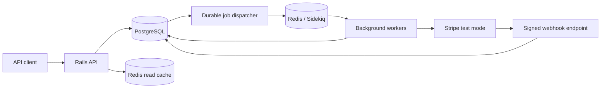

# Ledgerly Project Roadmap

Created: 2026-11-21
Status: Milestone 1 complete — ready for Milestone 2 (Stripe integration and recovery).
Project name: Ledgerly. The current workspace directory is named `Ledgerdy`.

## How to use this file

This file is the source of truth for project scope, progress, decisions, and evidence.

- Read it before starting project work and reference the relevant milestone in updates.
- Complete work in dependency order. The four weeks below are planning estimates, not completion claims.
- Check a task only after its acceptance checks pass. Record the commands, results, and evidence paths in the work log.
- Update this file when scope or implementation decisions change, and identify the next unfinished task before stopping.
- Keep actual measurements separate from targets. Never put an unmeasured target on a resume.

## Goal and scope

Build a Rails API that ingests metered usage, generates invoices, and reconciles Stripe test-mode payments while preventing duplicate billing effects during retries, concurrent execution, and out-of-order webhook delivery.

Initial scope: one currency per invoice, integer quantities, fixed per-unit metered prices, UTC billing periods, and Stripe test mode. Taxes, discounts, prorations, foreign exchange, production payment rollout, and a custom frontend are outside the initial release.

Use the foundation stack: Rails 8.1 API mode (updated from the proposed Rails 7; see decision log), PostgreSQL, Sidekiq, Redis, Stripe, RSpec, SimpleCov, Sorbet, RuboCop, Docker Compose, and GitHub Actions. Confirm and pin compatible, supported dependency versions during setup; record any change to the proposed Rails major version before implementation.

## Billing and reliability rules

1. PostgreSQL is authoritative for usage, invoices, payment state, and ledger balances. Redis is for queues and disposable read caches.
2. Store money in integer minor units with an explicit currency. Snapshot prices on invoice lines so later plan changes cannot change historical invoices.
3. Use half-open billing periods: `period_start <= occurred_at < period_end`. Define the late-usage policy before implementing invoice generation.
4. Enforce idempotency with database uniqueness and transactions. Application-level existence checks alone are insufficient under concurrency.
5. The same usage key and payload returns the original result. Reusing that key with a different payload returns a conflict.
6. Generating the same subscription-period invoice repeatedly or concurrently produces one invoice, one set of line items, and one issuance journal.
7. Each journal has multiple debit/credit rows whose totals match within one currency. Do not assert that there is exactly one ledger row per Stripe event.
8. Deduplicate both webhook delivery by Stripe event ID and financial effects by the underlying payment/refund identity. Different events may describe the same payment.
9. Use Stripe-managed invoice collection for the initial integration: a local invoice maps to one Stripe invoice. Do not also create a separate charge or PaymentIntent for that invoice. Subscription synchronization must not create a second recurring billing path.
10. Persist stable idempotency keys and remote identifiers for outgoing Stripe operations. Recover from timeouts by reconciling remote state before creating a new operation.
11. Persist webhook receipt before acknowledging it. A durable dispatch record and recovery process must cover failure between database commit and Sidekiq enqueue.
12. Retryable failures must leave work recoverable. A crash after applying an effect must not cause that effect to be applied twice.

## Architecture



Keep Stripe network calls outside long-running database transactions. Persist intent first, perform the remote operation with a stable idempotency key, and then persist the result. Recovery jobs reconcile interrupted transitions.

## Data model checklist

| Entity | Required data and constraints |
| --- | --- |
| `customers` | API identity, billing identity, unique nullable Stripe customer ID |
| `plans` | Metric, integer unit price, currency, billing cadence |
| `subscriptions` | Customer/plan references, lifecycle, billing boundaries, Stripe mapping when applicable |
| `usage_events` | Customer/subscription, metric, positive integer quantity, occurrence time, idempotency key, request fingerprint; unique key within its documented scope |
| `invoices` | Subscription, billing period, currency, amount, lifecycle, unique Stripe invoice ID; unique subscription and billing period |
| `invoice_line_items` | Invoice, metric, aggregated quantity, snapshotted price, amount, usage allocation reference |
| `ledger_transactions` | Journal type, invoice/payment/refund reference, unique business-effect key |
| `ledger_entries` | Journal, account, debit, credit; invoice/currency via the journal; nonnegative amounts and exactly one positive side per row |
| `stripe_events` (Milestone 2) | Unique Stripe event ID, type, raw payload, processing state, attempts, last error, processing timestamps |
| `outbox_records` (Milestone 2) | Durable dispatch intent, destination job, reference, availability and dispatch state |

Add foreign keys and correctness constraints from the start. Preserve those in the baseline; defer optional performance indexes to the optimization milestone. Journal balance needs transaction-level validation and tests; row-level checks alone cannot enforce a total across multiple entries.

## Milestone 0 — Foundation (start of Week 1)

- [x] Confirm Ruby/Rails/dependency versions and record them in the decision log.
- [x] Scaffold the API application in a dedicated `app/` directory, keeping the existing reference repositories separate.
- [x] Add Docker Compose services for API, PostgreSQL, Redis, and Sidekiq, with health checks and persistent database storage.
- [x] Add `.env.example`, ignored secrets, and documented setup/migration/test commands.
- [x] Configure RSpec, SimpleCov, RuboCop, and Sorbet. Start coverage collection before application code loads.
- [x] Establish API-key authentication, JSON validation/error conventions, pagination limits, and a health endpoint. Stripe webhooks use signature verification instead of API-key authentication.
- [x] Create an initial GitHub Actions workflow for RSpec and RuboCop; expand it in Week 4.

Acceptance status: passed from a clean GitHub checkout. All services booted healthy, setup exited 0, the real worker smoke passed, and `bin/ci` passed (44 examples; clean lint and initial typing). The first hosted GitHub Actions run passed. See [verification evidence](docs/verification/milestone-0/README.md).

Acceptance: a clean checkout can boot the services, create/migrate the database, serve health checks, and run a smoke test using documented commands. No secrets are committed.

## Milestone 1 — Core API and accounting (Week 1)

- [x] Implement migrations, models, relationships, and required database constraints.
- [x] Implement customer and plan creation/read endpoints plus subscription creation, retrieval, and supported lifecycle transitions.
- [x] Document usage idempotency scope, subscription overlap rules, rounding, billing boundaries, and late-usage handling. See [billing rules](docs/BILLING_RULES.md).
- [x] Implement `POST /api/v1/usage_events` with request fingerprints and database-backed idempotency.
- [x] Implement invoice generation for one subscription-period in a database transaction, including line items, usage allocation, and a balanced issuance journal.
- [x] Implement paginated customer invoice lists, invoice detail, and ledger-derived balance endpoints.
- [x] Add request/service tests for validation, authentication, boundary timestamps, price snapshots, duplicate requests, payload conflicts, rollback, and concurrent invoice generation.

Acceptance status: passed from a clean GitHub checkout and fresh schema load. All 138 specs, lint, initial typing, autoload checks and hosted CI passed. Live four-request HTTP duplicate tests produced one event/invoice and balanced entries. See [Milestone 1 evidence](docs/verification/milestone-1/README.md).

Acceptance: repeated and concurrent usage requests have one stored result; repeated and concurrent invoice generation produces one invoice; no usage is billed in two invoices; failed generation leaves no partial invoice or ledger state; every journal balances.

## Milestone 2 — Stripe integration and recovery (Week 2)

- [ ] Confirm current Stripe SDK/API contracts against official documentation and pin the API version used by fixtures and tests.
- [ ] Implement the local-invoice-to-Stripe-invoice workflow with stable outgoing idempotency keys and persisted operation state.
- [ ] Implement webhook signature verification against the exact request bytes, with invalid signatures rejected before storage or dispatch.
- [ ] Store verified events durably under a unique Stripe event ID and write dispatch intent in the same database transaction.
- [ ] Implement the outbox dispatcher and a recovery sweep for undispatched events and interrupted processing.
- [ ] Process `invoice.paid`, `invoice.payment_failed`, and `charge.refunded` with database locking, business-effect uniqueness, and transactional ledger/state updates.
- [ ] Support multiple partial refunds using individual refund identities; prevent cumulative refunded amounts from exceeding the recognized payment.
- [ ] Handle unknown event types, missing mappings, duplicate events, and stale/out-of-order state transitions explicitly. Reconcile against Stripe where local information is insufficient.
- [ ] Configure bounded exponential retry backoff with jitter, Sidekiq dead-job handling, failure inspection, and safe manual replay.
- [ ] Test concurrent delivery, distinct event IDs for the same payment, duplicate refund notifications, and crashes before/after commit or enqueue.

Acceptance: replaying events two or three times in shuffled order produces the same financial state as one successful processing pass. There is one journal per logical financial effect, balanced entries, and no repeated Stripe collection. Temporary failures recover, and exhausted jobs remain inspectable and replayable.

## Milestone 3 — Baseline, load, and optimization (Week 3)

- [ ] Write a deterministic, rerunnable test-data generator for at least 50,000 invoices with realistic customer distribution, line items, usage, payments, and ledger records.
- [ ] Verify fixture counts and accounting invariants before benchmarking. Run benchmarks only against an isolated test environment.
- [ ] Write repeatable load scenarios for signed webhook ingestion and a heavy endpoint such as the customer invoice list.
- [ ] Record the baseline commit, machine/container resources, worker concurrency, dataset seed, endpoint parameters, warm-up, duration, arrival rate, and cache state.
- [ ] Run and save the baseline before adding performance optimizations. Keep required integrity indexes enabled.
- [ ] Capture endpoint p50/p95/p99, request failures, incoming event rate, successfully processed unique event rate, queue latency, backlog, query counts, and database query plans.
- [ ] Add justified composite indexes using query plans, eliminate N+1 queries with Bullet-assisted development checks, and use bounded pagination.
- [ ] Add Redis caching for balance/summary reads with explicit invalidation after committed ledger changes. Test cache outage fallback and stale-data behavior.
- [ ] Re-run the identical workload on the same fixture and resource configuration. Report cold and warm cache results separately.
- [ ] Run duplicate/out-of-order replay against the 50,000-invoice dataset and verify payment/refund effects and ledger balances.
- [ ] Save a comparison with reproducible commands, raw outputs, commit IDs, and limitations.

Acceptance: another person can reproduce the measurements from the saved instructions. Throughput counts completed unique effects as well as accepted deliveries; backlog growth and error rates are disclosed. Performance changes preserve all correctness checks.

## Milestone 4 — Quality and portfolio release (Week 4)

- [ ] Reach greater than 90% measured line coverage; treat 94% as a stretch target. Include core error, concurrency, and recovery paths in tests.
- [ ] Add useful Sorbet signatures to core models, billing services, and webhook processors; run the type checker in CI.
- [ ] Finish CI with PostgreSQL/Redis services, RSpec coverage enforcement, RuboCop, and Sorbet.
- [ ] Document API examples, setup, architecture, schema, billing decisions, failure recovery, webhook replay, and test-mode Stripe setup in the README.
- [ ] Publish the measured benchmark report with raw evidence paths and a before/after comparison.
- [ ] Document operational checks: undelivered outbox records, failed/dead jobs, queue latency, unreconciled payments, and ledger imbalance detection.
- [ ] Run the full acceptance suite from a clean database and complete an end-to-end test-mode invoice/payment/refund demonstration.
- [ ] Write resume bullets using only results supported by the evidence register below.

Acceptance: clean setup succeeds, all CI checks pass, the demo is repeatable, and every numerical claim links to a completed measurement.

## Evidence and measurement register

Targets/examples come from the proposal. Only the actual-result column records achieved measurements, with the scope stated explicitly.

| Claim | Target / example | Required proof | Actual result |
| --- | --- | --- | --- |
| Event throughput | 5,000+ events/minute | Signed load test; accepted deliveries and completed unique events/minute; duration, errors, backlog and queue latency | Not measured |
| Duplicate billing prevention | Zero duplicates in the tested scenarios | Concurrent, repeated and shuffled event replay; unique logical payment/refund journals; outgoing collection count; balanced ledger assertions | Core concurrent usage/invoice checks passed; Stripe duplicate-charge/replay scenarios remain untested. [Evidence](docs/verification/milestone-1/README.md) |
| Dataset size | At least 50,000 invoices | Seed command, deterministic seed, counts, and integrity checks | Not generated |
| Heavy-endpoint latency | Example: p95 480 ms → 90 ms | Comparable baseline/optimized runs with identical fixtures and resources; request failures; cold/warm cache disclosure | Not measured |
| RSpec coverage | Greater than 90%; stretch 94% | Full-suite command, SimpleCov configuration and report showing actual line coverage | Milestone 1: 447/456 application lines (98.02%), 138 specs; Stripe/recovery coverage pending. [Evidence](docs/verification/milestone-1/README.md) |

Suggested evidence layout, to create as measurements are produced:

```text
docs/benchmarks/<run-id>/
  environment.md
  commands.md
  dataset-counts.json
  baseline.json
  optimized.json
  replay-results.txt
  query-plans.txt
  comparison.md
```

Store the commit and fixture identity with each run. Keep secrets and customer data out of evidence. A test with no duplicate charges supports a claim about those tested failure scenarios; it does not prove that duplicates are impossible under every condition.

## Definition of done for each milestone

- Relevant tasks and acceptance checks pass.
- Required automated checks pass, and important recovery/concurrency cases have evidence.
- Setup/API/operational documentation matches the implementation.
- This roadmap reflects completed work, open decisions, actual measurements, and the next task.

## Decision log

| Date | Decision | Rationale / follow-up |
| --- | --- | --- |
| 2026-11-21 | Use this roadmap as the project reference | Update it as implementation and evidence evolve. |
| 2026-11-21 | Keep the application in `app/` | The workspace currently contains reference repositories rather than an application. |
| 2026-11-21 | Use Stripe-managed invoice collection for the initial release | Map each local invoice to one remote invoice and avoid competing collection paths. Verify contracts during Milestone 2. |
| 2026-11-21 | Add journal headers and durable dispatch records | Provide business-effect uniqueness and recovery across database/queue boundaries. |
| 2026-11-21 | Move the foundation from Rails 7 to Rails 8.1 | Rails 7.2 reached its final release; use a security-supported release for new development. Sources: https://rubyonrails.org/2026/9/24/Rails-Version-7-2-4-has-been-released and https://rubyonrails.org/maintenance. |
| 2026-11-21 | Commit logical batches near 1,000 changed lines to `amovingman/Ledgerly` | User requested frequent commits; exclude bundled reference repositories and generated runtime files. |
| 2026-11-21 | Pin Ruby 3.4.13, Rails 8.1.4.1, Bundler 4.1.0 and all direct gems | RubyGems versions checked; `app/Gemfile.lock` includes macOS arm64 and Linux arm64/x86_64. Local tools: PostgreSQL 17.12, Redis 8.10.3, Docker 29.10.0, Compose 5.8.0, Colima 0.10.3. Container Redis is pinned independently in Compose. |
| 2026-11-21 | Scope the initial Sorbet check to strict pagination value objects | Keep the type check useful and passing now; model/service signatures expand in Milestone 4. |
| 2026-11-21 | Isolate test database settings from development | Tests use `TEST_DB_DATABASE` / `TEST_DATABASE_URL`, ignore inherited generic database overrides, and refuse names without a test suffix; CI/specs reject production invocation. |

Milestone 1 billing decisions are defined in [docs/BILLING_RULES.md](docs/BILLING_RULES.md): UTC calendar months, late usage accepted until issuance, non-overlapping customer/metric subscriptions, contract price snapshots, and issuance debits to receivables/credits to usage revenue. Payments/refunds remain in Milestone 2; credit adjustments are outside initial scope.

## Work log

| Date | Work completed | Validation / evidence | Next task |
| --- | --- | --- | --- |
| 2026-11-21 | Created the roadmap and persistent project-reference instructions | Inspected workspace; no Rails application found. No application tests or benchmarks run. | Milestone 0: confirm versions and scaffold the Rails API. |
| 2026-11-21 | Installed development tools; scaffolded Rails 8.1 API in `app/`; pinned dependencies | `ruby --version`, `bundle --version`, `bundle exec rails --version`, and `bundle check` passed. Colima VM started. Application acceptance checks still pending. | Add and verify auth, errors, health, tests, Compose, and CI. |
| 2026-11-21 | Implemented API auth, JSON errors, pagination, health endpoints, test database guards, and quality tooling | Container `bin/ci`: 44 examples, 0 failures; RuboCop: 41 files, no offenses; scoped Sorbet: no errors. Foundation-only SimpleCov line coverage: 102/110 (92.72%). Native Rails autoload and database isolation/production guard checks passed. | Complete live worker/HTTP and clean-checkout acceptance; commit infrastructure and documentation. |
| 2026-11-21 | Added Compose, pinned development images, setup docs, environment example, and GitHub Actions | Full stack healthy; real `bin/smoke` passed; live HTTP checks returned 200 health/authenticated, 401 unauthenticated, 404 unknown route, 400 malformed JSON. First commits pushed: `f8e7d19`, `d443842`. | Verify the committed infrastructure from a clean checkout and inspect hosted CI. |
| 2026-11-21 | Completed Milestone 0 acceptance from clean GitHub source at `70aea13`; saved outputs and setup evidence | [Verification report](docs/verification/milestone-0/README.md): healthy full stack, real worker execution, 44 specs passing, 41 Ruby files lint clean, initial Sorbet passing; [hosted CI passed](https://github.com/amovingman/Ledgerly/actions/runs/44962119095). Workflow checkout runtime updated to the verified Node 24 release after a deprecation annotation. | Milestone 1: implement migrations/models and core API, beginning with billing rules and database constraints. |
| 2026-11-21 | Started Milestone 1 and documented billing, lifecycle, late-usage, locking, and account-mapping rules | Implementation and checks in progress; no new acceptance claims yet. | Verify migrations, model constraints and schema round-trip, then build the API and billing services. |
| 2026-11-21 | Implemented eight core models, database constraints, schema dump, contract price snapshots and subscription lifecycle services | Migration and fresh `db:schema:load` verified in isolated test databases; full batch check: 70 specs passing, 52 linted files clean, Sorbet passing. Invoice/usage services and endpoints are still pending. | Build resource endpoints and customer-scoped idempotent usage ingestion. |

| 2026-11-21 | Implemented authenticated customer/plan/subscription endpoints, cancellation and idempotent usage API | Full container check: 113 passing specs, 63 linted files clean, scoped Sorbet passing. Tests cover normalized timestamps, cross-customer isolation, key conflicts/replays, late usage, payload types and boundaries. Model batch `9318d52` passed hosted CI. | Implement atomic invoice generation, invoice/balance reads, and real concurrency/rollback checks. |

| 2026-11-21 | Added atomic invoice issuance, one-time allocation, balanced immutable journals, invoice reads and per-currency receivable balances | Full container check: 138 passing specs; 73 linted files clean; scoped Sorbet passing. Real four-thread duplicates produce one event/invoice/journal; ingestion/issuance race, rollback after allocation, month boundaries and integer overflow are verified. | Verify the committed schema from scratch, live API workflow, and hosted CI before marking Milestone 1 complete. |

| 2026-11-21 | Completed Milestone 1 acceptance against clean GitHub source `2a1aa1d` and a fresh schema-loaded test database | [Evidence](docs/verification/milestone-1/README.md): 138 specs passing, 73 linted files clean, scoped typing/autoload passing; [hosted CI green](https://github.com/amovingman/Ledgerly/actions/runs/44964611834). Real HTTP concurrency verified one event and one invoice, balanced postings, immutable replay and late-usage rejection. | Milestone 2: verify Stripe contracts/version and implement durable collection/webhook processing with recovery. |

## Next action

Start Milestone 2 by checking the current official Stripe SDK/API contracts, pinning the SDK/API version, and designing the persisted outgoing-operation and webhook/outbox state transitions. Billing collection and Stripe webhook reconciliation have not started.
