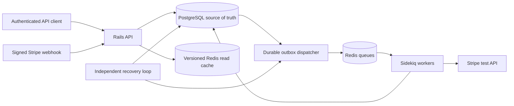
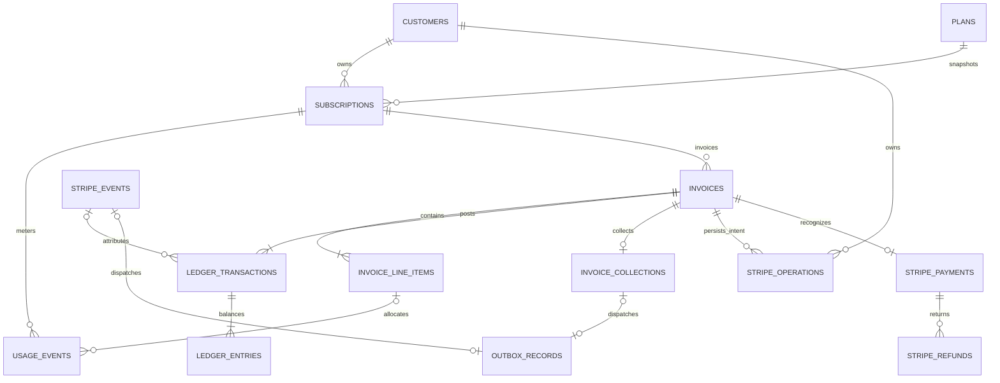

# Billing architecture and schema

[ROADMAP.md](../ROADMAP.md) owns the scope and measured evidence. Rails 8.1 serves an API backed by PostgreSQL; Redis holds Sidekiq jobs and disposable read caches. Stripe integration is test-mode invoice collection, not a second subscription billing engine.

## Stored relationships

See [the executable schema](../app/db/schema.rb) and migrations for actual columns, nullability, foreign keys, exclusion/check constraints and unique indexes. A persisted outbox row references exactly one event or collection. Distinct webhook event IDs can describe the same payment/refund, so receipt uniqueness and effect uniqueness are separate constraints.

## Transaction boundaries

Usage keys are scoped to a customer and bind a canonical request fingerprint. The same key/payload returns the original immutable representation; a changed payload conflicts. Customer locking serializes ingestion with monthly invoice issuance. Periods are half-open UTC calendar months and prices are snapshotted. Issuance commits the invoice, lines, usage allocation and journal together.

A collection intent and outbox commit before background work. Each outgoing operation persists its exact payload and stable idempotency key before a provider call. Remote calls occur outside long database transactions. Timeout recovery reconciles provider metadata and refuses a fresh ambiguous create past the conservative retry window. The application creates/finalizes one Stripe invoice; it never creates another standalone charge/PaymentIntent or mirrors subscriptions into a second recurring billing path.

Signature verification uses exact bytes before storing the receipt. Receipt/outbox commit before acknowledgment. Event advisory locking prevents concurrent processing of the same receipt; customer row locking and database business-effect uniqueness protect distinct events describing the same money. Posting commits financial identities, balanced journals, invoice state and receipt completion together. A crash/retry cannot rely on an in-memory existence check for deduplication.

| Journal | Debit | Credit |
| --- | --- | --- |
| Invoice issuance | Accounts receivable | Usage revenue |
| Recognized payment | Stripe clearing | Accounts receivable |
| Succeeded refund | Sales returns | Stripe clearing |

Money uses integer minor units and an explicit currency. Balances never add currencies together. This ledger tracks gross invoice/payment/refund effects; it does not model Stripe fees, bank payouts, tax, FX, disputes or every real-world adjustment. A Stripe dashboard cash balance is a different measure from this API's receivable balance.

## Reads and reliability

Invoice headers and receivable summaries use bounded versioned caching. The customer read version commits with invoice/journal changes; a late old fill cannot become the new version. PostgreSQL remains authoritative and reads fall back on cache failures. [CACHING.md](CACHING.md) specifies size/TTL/page limits, transaction behavior and tests.

Recovery selects unfinished work in SQL and preserves a locked recheck. SDK clients are reused per worker thread to bound persistent transport pools. Failed/review work remains inspectable. [OPERATIONS.md](OPERATIONS.md) documents audits and safe replay; [TYPING.md](TYPING.md) describes static contracts and remaining dynamic boundaries.
