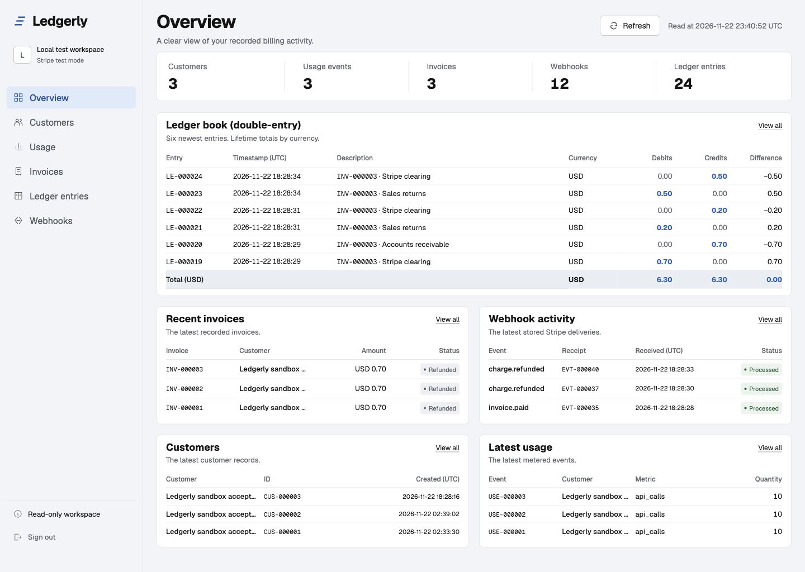

# Milestone 5 — Dashboard acceptance

[ROADMAP.md](../../../ROADMAP.md) is authoritative. Milestones 0–5 are complete and published for the Stripe test-mode portfolio project. The user authorized publishing all outstanding performance and dashboard work. Commit identities and hosted CI are recorded in the roadmap/release history; earlier measurements retain their own source manifests.

## Hosted release verification

Implementation commits `f93bda6` and `9057540` are published on main. Both [GitHub Actions jobs passed](https://github.com/amovingman/Ledgerly/actions/runs/45085650592) for dashboard source `9057540c704b9fb4dfd3b9f7759e2a7ce8fa2c05`: tests/quality and clean Compose startup/HTTP billing/real worker execution. Hosted results: 241 specs, five Node tests, 163 linted files, typing/probes/RBI/autoload; coverage 1,437/1,473 lines (97.55%), 284/337 branches (84.27%). The local 97.28% report below is retained with its own environment; the two coverage results are not conflated. [Machine receipt](hosted-ci.json), [selected job log lines](hosted-checks.txt).

A documentation-only follow-up records these observed results without changing application source.

## Accepted result

All five read-only views use the existing local sandbox database. An authenticated viewer can follow a customer → usage → invoice → journal and inspect webhook processing/related entries. No billing mutations or outgoing Stripe requests were made during this dashboard check.

| Check | Observed result |
| --- | --- |
| Full isolated `bin/ci` | 241 examples, zero failures; 163 Ruby files lint clean; Sorbet, positive/negative probes, RBI drift and autoload passed |
| SimpleCov | 1,433/1,473 lines (97.28%); 284/337 branches (84.27%) |
| Dashboard request examples | 16: auth/expiry/key rotation, CSRF and real sign-out form, cookie-only API-write rejection, pagination/filter isolation, exact money and raw-payload exclusion |
| Native Node checks | Five passed, including exact large/negative cents, UTC, escaping and signed ledger-row differences |
| Python benchmark-script regressions | Five passed |
| Formal hero/desktop gates | 81.58% / 82.15%, above the unchanged 72% requirement; no forced phases |
| Final comp-frame comparison | 82.04% at actual 1487×1058; independent verdict **ship** for the listed alignment/persistence fixes |
| Other viewport checks | 1440×900 and 1280×900: no document horizontal overflow; first rows from all five areas within 900px. Phone 390×844: labelled financial fields and working navigation |
| Accounting | Original counts unchanged; all eight invariant checks report zero violations |

The local database contains 3 customers, 3 usage events, 3 invoices, 12 journals/24 ledger entries, 3 payments, 6 refunds and 12 webhook receipts. Lifetime totals are USD 6.30 debits/USD 6.30 credits, difference USD 0.00. These are sandbox verification records, not production customers or the separate 50k benchmark dataset. No synthetic seed was added.

[Comp-frame capture](comp-size.jpg), [1280px desktop](desktop-1280.jpg), [phone overview](mobile.jpg), [customer](customer.jpg), [invoice](invoice.jpg), [webhook](webhook.jpg), [error state](error.jpg), [sign-in error](login-error.jpg). Detail screenshots from initial functional acceptance remain valid; subsequent changes were confined to the overview and shared chrome.

## Browser verification

- Search, clear filters, real page 2-of-3 pagination, status filters and a recoverable invalid-filter error worked.
- Customer-scoped usage linked to its invoice and eight invoice-linked ledger entries. A refund webhook showed its actual two related journal rows.
- Manual refresh, incorrect-key feedback, successful login, session expiry and CSRF-protected POST sign-out were exercised. No console errors/warnings appeared in the final flow.
- Overview usage identifiers open the corresponding customer-scoped usage list. Webhook receipt identifiers open details containing the full Stripe event ID.
- Phone navigation closes on selection, contains focus while open and leaves the closed sidebar inert. Section/detail navigation resets focus/scroll. Skip to content focuses `main` without changing the hash route.
- At 1440×900, first customer/usage rows begin around y=873. At 390px, ledger records expose account, currency, debit, credit and entry difference without hidden columns. [1440px observations](responsive-1440.json), [1280px observations](responsive-1280.json).

## Visual acceptance and retained failures

The user approved **A — Statement book** and existing local data. [Approved mockup](approved-mockup.png), [built-in image generation prompts](mockup-prompts.json), [final comparison](visual-comparison.png), [raw comparison](visual-diff.json), [gate/reviewer receipt](visual-acceptance.json).

The initial 69.18% comparison remains under [initial evidence](initial/visual-diff.json), with its [paired image](initial/visual-comparison.png). The final refinement restored compact semantic tables, wider navigation lettering, aligned Refresh/timestamp controls and the approved sidebar footer. It preserved real source data, exact currency arithmetic, labelled phone records and the existing read-only trace.

The machine spatial comparison uses the actual 1487×1058 approved frame. A separate [1440 normalized-region attempt](responsive-1440-failed.json) scored 77.59% overall but incorrectly clipped fixed navigation/title regions during normalization; its missing-region result is retained as failed. It is **not** reported as a passing 1440 machine gate. Actual 1440/1280 layouts were separately inspected and measured in the browser. The ordinary desktop gate passed 82.15% on the named comp-frame desktop capture; the 390px phone capture was also supplied. No threshold, region definition or phase was forced to pass.

The fresh reviewer scored its prior two findings—control alignment and normal-gate persistence—resolved and returned **ship** at that scope. The documenter updated token-bearing [DESIGN.md](../../../DESIGN.md) and `.impeccable/design.json`, validating YAML/JSON, references and source values. Geist-family detector warnings are intentional in this approved Operate interface. The Chrome-specific taste inspector remains unavailable; actual verification used the in-app browser.

Real names, IDs, periods, statuses and accounting directions replace illustrative mockup values. The overview usage table summarizes event/customer/metric/quantity; timestamps remain in the scoped usage view. Long names truncate on desktop with full text available through titles/detail links and wrap on phones. These are documented data/readability adaptations, not claims of pixel-identical placeholder content. No mockup pixels ship as UI.

## Reproduction and scope

Follow [dashboard setup](../../DASHBOARD.md). Full Ruby checks used the isolated `ledgerly_dashboard_test` database and separate Redis; development and mixed benchmark databases were not test targets. Native frontend checks run with `node --test scripts/test_dashboard.mjs`; benchmark regressions with `python3 -m unittest discover -s scripts -p 'test_*.py'`. Test services were stopped afterward, preserving volumes; development services remain healthy.

Sanitized [checks](checks.txt), [Node results](node-tests.txt), [Python results](python-tests.txt), [accounting](accounting.json), [source manifest](source-manifest.json), [runtime](runtime.json) and [review](review.md) accompany this report. Dashboard endpoints have not been included in historical performance measurements; no new latency/throughput claim is made for them. The project remains a test-mode portfolio release.
